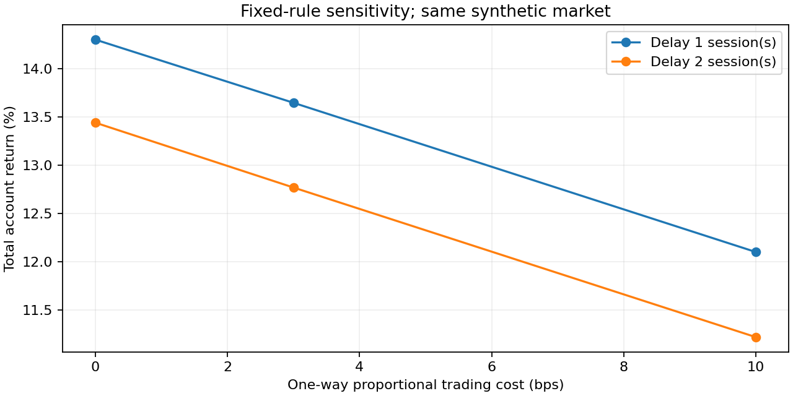

[](https://github.com/Mingju-Zhang-CBS/systematic-strategy-lab/actions/workflows/checks.yml)

[Research overview](https://github.com/Mingju-Zhang-CBS/Quant) · [Mingju Zhang](https://github.com/Mingju-Zhang-CBS)

# Systematic Strategy Lab

**Research question:** How do signal timing, trading costs, cash availability and corporate actions change the economics of a portfolio rule?

This project implements a small account simulator in which investment decisions, executed trades and reported P&L can be reconciled. It compares a fixed multi-asset momentum rule with static and passive controls, then evaluates six predetermined cost/delay cases.

**Python 3.12 · NumPy · pandas · 6 local tests passed · Offline demo · MIT**

## Read the result first

The public run uses **1,512 synthetic sessions** and five simulated asset roles named SPY, IEF, GLD, DBC and QQQ. A 252-session warmup leaves **1,260 account rows per strategy**. These labels do not turn the simulation into historical ETF evidence.

| Synthetic account | Total return | Excess Sharpe | Maximum drawdown | Trading fees, currency units |
| --- | ---: | ---: | ---: | ---: |
| Momentum | 13.65% | 0.049 | -17.61% | 701.92 |
| Static | 9.35% | -0.065 | -16.94% | 63.17 |
| Spy | 14.53% | 0.087 | -24.72% | 29.70 |
| Qqq | 85.03% | 0.601 | -36.95% | 29.70 |

**Research interpretation:** momentum earns a small excess Sharpe in this generated market. The QQQ-like passive role earns more with a larger drawdown. Their exposures differ, so the return ranking does not isolate signal skill. The account and cost conventions are the main contribution of this demonstration.


## What this project demonstrates

| Skill | Concrete evidence |
| --- | --- |
| Systematic portfolio research | Explicit momentum lookback, skip, rebalance dates, caps and covariance scaling. |
| Financial accounting | Separate cash, marked holdings, dividend entitlements and later payments. |
| Execution modeling | Decision/execution separation, integer trade quantities, sell-first funding and proportional fees. |
| Risk analysis | Net return, excess Sharpe, initial-capital-aware drawdown and turnover. |
| Experimental discipline | Four controls and six fixed sensitivity cases; no best-case promotion. |
| Software correctness | Per-day NAV identities, future-price perturbations, split tests and an inspectable order ledger. |

## The complete research workflow


1. **Validate a common market panel.** Every supplied session contains the five expected tickers, raw closes, event fields and a consistent annual cash rate.
2. **Build economic returns.** Apply split multipliers and dividend entitlements once. A total-return index informs signals; the actual account keeps paid cash and receivables separate.
3. **Form a decision at a close.** Positive momentum over observations `t-252` through `t-21` determines eligible active assets. Equal target weights are capped at 50% per asset and 99% gross. A trailing 126-observation covariance reduces risk toward a 10% annual target.
4. **Execute at a later close.** Freeze target weights. Size integer quantities using then-observed NAV/prices, sell before buying, and scale purchases to available cash including fees.
5. **Maintain the account.** Prior cash earns interest over actual elapsed days. Ex-date dividends become receivables, payable after 20 supplied sessions. Fees apply to buys and sells.
6. **Reconcile and evaluate.** Bridge every ending NAV to its economic components before calculating performance and predetermined stress cases.

### The accounting invariant

```text
Ending NAV = Prior NAV + Stock price P&L + Dividend entitlement
             + Cash interest - Trading fees

Ending NAV = Cash + Dividend receivables + Marked stock holdings
```

Across **5,040 recorded strategy-day rows**, the largest absolute bridge residual is **2.81e-11 currency units**. The [worked walkthrough](docs/WALKTHROUGH.md) traces an actual synthetic dividend event through this identity.

### Why the controls matter

| Control | Decision policy | Exposure convention |
| --- | --- | --- |
| Momentum | Initial eligible close, then month ends | Four active assets, positivity filter and volatility scaling. |
| Static | Same decision schedule | Equal target weights; no volatility scaling. |
| SPY / QQQ | Enter once after the initial decision | Hold stock; leave later paid dividends in cash. |

All controls share evaluation dates, financing conventions and costs. Target caps apply at decisions; prices can move realized weights away from those targets afterward.

## Costs and execution delay



The experiment fixes costs at 0, 3 or 10 bps per traded notional and delay at one or two supplied sessions. It reports every combination. The change from 0 to 10 bps and from one to two sessions is an economic sensitivity exercise, not a parameter search for the best historical curve.

## Reproduce the study

```text
python -m venv .venv
```

Activate the environment with `.venv\Scripts\Activate.ps1` in Windows PowerShell, or `source .venv/bin/activate` on macOS/Linux. Then:

```text
python -m pip install -r requirements.lock.txt
python -m pip install --no-deps -e .
python -m pytest
python -m strategy_lab --output local-runs/demo
```

Use Python 3.12 and a new or empty output directory. After dependencies are installed, the synthetic demonstration needs no network access. The checked-in run is in `reports/demo/`; new runs go to ignored `local-runs/`.

### Use your own market panel

```text
python -m strategy_lab --csv private-data/market.csv --output local-runs/user-study
```

The CSV fields are `date,ticker,close,dividend,split,volume,cash_rate`. Use raw closes, split ratios as new shares per old share, ex-date dividends per post-split share and annual continuous cash rates in decimals. Mixing adjusted prices with separate event adjustments double-counts corporate actions. See [METHODS](docs/METHODS.md) for the complete contract.

## Engineering map and verification

| Implementation | Responsibility |
| --- | --- |
| [`core.py`](strategy_lab/core.py) | Schema validation, synthetic market, signals, constrained trading, account ledger and metrics. |
| [`__main__.py`](strategy_lab/__main__.py) | Four-strategy comparison, sensitivity grid, CSVs, plots and report. |
| [`test_accounting.py`](tests/test_accounting.py) | Independent cash examples, future-data invariance, delayed dividends, splits and drawdown boundaries. |

Each strategy outputs `ledger.csv`, `decisions.csv` and `orders.csv`; the study also writes `sensitivity.csv`, metrics and a source-bound manifest. This makes a reported curve traceable to individual account events.

## Assumptions and limits

- Synthetic dynamics are not historical ETF returns, an execution record or evidence of alpha.
- Closing-price target-notional execution is a modeling convention; daily bars do not establish attainable fills or market capacity.
- Dividend payment lag is assumed, not sourced from historical payment dates. Volume is validated but is not a participation-limit model.
- The simulator is long-only and forbids overdrafts. It does not model borrow, taxes, impact, margin or client mandates.
- Supplied sessions define the calendar. Previously inspected real history remains exploratory when used through the adapter.

## Explore the evidence

| Read | Purpose |
| --- | --- |
| [Worked walkthrough](docs/WALKTHROUGH.md) | Follow the research logic and a numerical example. |
| [Methods and input contract](docs/METHODS.md) | Check assumptions, conventions and supported interfaces. |
| [Executed research report](reports/demo/REPORT.md) | Inspect the recorded results and limitations. |
| [Interview discussion](docs/INTERVIEW.md) | Practice explaining decisions and failure modes. |
| [Resume evidence](docs/RESUME.md) | Trace draft claims to measured artifacts. |
| [Provenance](docs/PROVENANCE.md) | Understand attribution, AI assistance and data rights. |

Development was AI-assisted. The accounting engine and examples were independently written from public financial concepts; restricted coursework, company systems and vendor histories are outside this repository. [MIT license](LICENSE).
