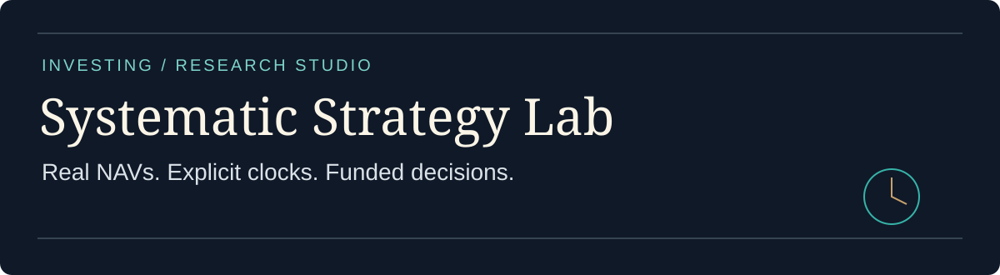
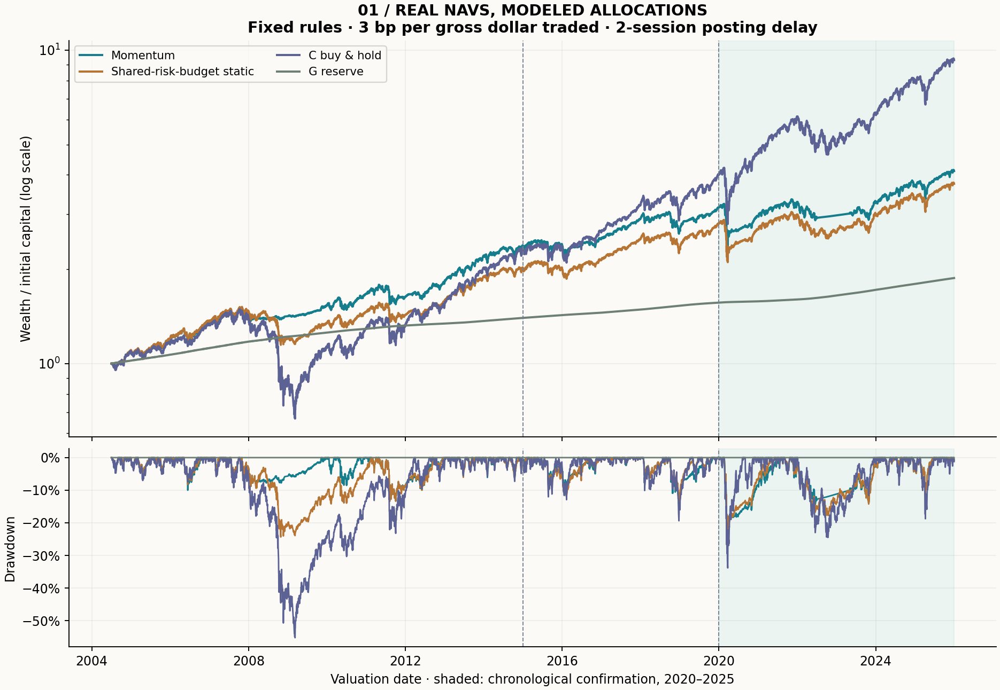
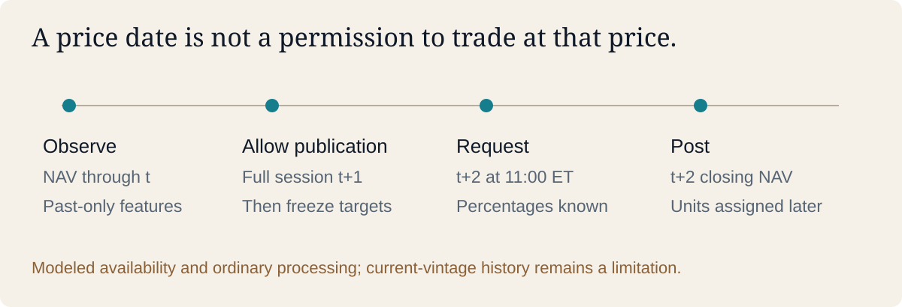
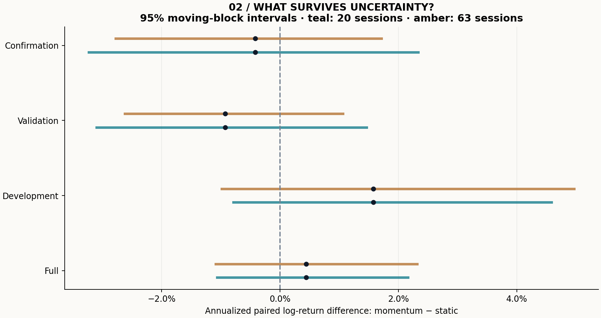

# Systematic Strategy Lab

**Real multi-asset fund NAVs · allocation research · funded implementation**

Does a momentum filter improve an allocation after publication delays, fees and a fair risk-budget comparison? I study five official TSP fund share-value series covering U.S. large-cap and smaller-company equities, international equities, bonds and a government-securities reserve. The study connects investment judgment to data lineage, temporal validation and daily account economics.

[Research findings](reports/real/REPORT.md) · [Worked explanation](docs/WALKTHROUGH.md) · [Methods](docs/METHODS.md) · [Data rights](DATA_RIGHTS.md) · [Validation](docs/VALIDATION.md) · [Portfolio directory](https://github.com/Mingju-Zhang-CBS/Quant)

## The result worth reading

In the **2020–2025 chronological confirmation window**, the fixed momentum allocation returned **30.69%**, versus **33.97%** for the static control using the same risk-budget procedure. The annualized paired daily log-return difference was **−0.42 percentage points**, with a 95% moving-block interval of **[−3.23, +2.33] percentage points** using 20-session blocks. The 63-session interval also contains zero. All nine predefined cost/delay scenarios produced a negative confirmation difference.

**The evidence does not establish an incremental momentum advantage.** A useful implementation can expose an economically weak hypothesis. These are modeled allocations on real fund NAVs, not observed fund trades or independently unseen future performance.



## What I built, and what it demonstrates

|Capability|Concrete implementation|Why it matters|
|---|---|---|
|Investment research|Fixed momentum, a shared-risk-budget static control, C and G buy-and-hold|Compare the signal with both a fair process control and opportunity cost|
|Financial data judgment|5,639 common NAV dates, source fingerprint, rights record and explicit current-vintage limitation|A downloadable file is not automatically a point-in-time total-return dataset|
|Portfolio and risk|Long-only whole-percent targets, trailing covariance, risk scaling and a reserve sleeve|Translate a signal into a funded, constrained allocation|
|Implementation economics|Publication lag, frozen requests, later NAV posting and two-leg friction|Separate what was known from what was later paid|
|Statistical reasoning|Chronological windows, continuous holdings, yearly diagnostics and paired block intervals|Keep uncertainty, unfavorable periods and model-selection limits visible|
|Research engineering|Offline packaged snapshot, 23 tests, ledgers, source-bound manifests and CI|Make every displayed result inspectable and reproducible|

My contribution is the independently written data contract, allocation/account engine, test suite, experiment protocol, reporting and interpretation. TSP supplies the public numerical NAV facts; upstream public methods and Python libraries retain attribution. Development and documentation were AI-assisted. No employer code, recruiting task or licensed market-data feed is included.

## Reproduce the real study

Use **Python 3.12**. Install the tested dependency closure in a fresh environment:

```bash
python -m venv .venv
# Activate .venv using your shell's standard activation command.
python -m pip install -r requirements.lock.txt
python -m pip install --no-deps -e .
python -m pip check
python -m pytest
python -m strategy_lab --real --output local-runs/real
python examples/explain_nav_transfer.py
```

The research command reads the checked-in snapshot and needs **no network, key, paid service or GPU**. Choose a new empty output folder for each run; existing results are not silently overwritten. The [checked-in report](reports/real/REPORT.md) contains four strategies, three chronological windows plus a full-period summary, 22 yearly slices, both uncertainty intervals and all nine stress scenarios. Configuration, data, code and generated-file fingerprints accompany the output.

## Read the information clock before the performance curve



The signal uses observations through **t**. A complete intervening NAV session is reserved for publication, targets are frozen after it, and a request is modeled at **11:00 New York time on t+2**, before that day's NAV is known. Posting at the closing NAV is an ordinary-processing assumption. The report also shows three- and five-session delays.

Historical publication timestamps and release vintages are unavailable. This conservative lag cannot eliminate unknown historical revisions. The protocol was recorded before this implementation calculated returns; development (July 2004–2014), validation (2015–2019) and confirmation (2020–2025) remain **historical temporal checks**, not prospective proof. No setting is selected from the confirmation results. Covariance uses only trailing observations and holdings continue across window boundaries.

## Income, costs and funding

TSP share NAVs already incorporate investment income and fund expenses. The real study adds **zero separate dividends**, **zero extra fund-expense debit** and **zero extra cash-interest credit**. G is a specific reserve fund earning its observed NAV return; it is not a universally accessible cash account. Underlying dividend ex/pay dates cannot be recovered from these fund NAVs.

The base stress charges **3 bp per gross dollar bought or sold**, including the reserve leg; it is not an actual TSP commission or measured bid/ask spread. At each transfer:

```text
after-fee value + modeled fee = pre-transfer value
fee = friction rate × sum(abs(new dollar holdings − old dollar holdings))
new units = frozen target percentage × after-fee value / posting NAV
```

For example, transferring $100,000 from G to C at 10 bp per leg leaves **$99,800.20** invested and pays **$199.80**. A subsequent 2% accumulation-NAV increase produces **$101,796.20**; adding a separate 2% dividend would double-count income. See the [executable example](examples/explain_nav_transfer.py).



## Scope, source and honest limits

The snapshot contains independently transcribed **public numerical facts** from the [official TSP service](https://www.tsp.gov/share-price-history/). The [rights record](DATA_RIGHTS.md) documents the factual-data/U.S.-government-work basis, attribution and exclusions; it does not invent a Creative Commons license for TSP or relicense third-party index data. Fund units are available only to eligible plan participants. Whole-percent targets and monthly transfer-count audits approximate core rules; fractional-unit rounding, exceptional processing, taxes, contributions and withdrawals are outside scope. This is not an ETF execution or complete participant-account simulator. The I Fund's benchmark changed during 2024.

The [legacy synthetic study](reports/demo/REPORT.md) remains a separately labeled accounting demonstration. Its raw-price engine tests split units, ex-date dividend receivables and delayed payments; its SPY/IEF/GLD/DBC/QQQ labels are simulated roles, not actual ETF histories. Run it with `python -m strategy_lab --output local-runs/synthetic` and `python examples/explain_accounting.py`. Its older static control has a different risk procedure and is not the real study's comparison.

## Continue the conversation

- [Methods and equations](docs/METHODS.md) — signal, units, risk, metrics and inference.
- [Numerical walkthrough](docs/WALKTHROUGH.md) — a request, funded transfer and NAV bridge.
- [Validation record](docs/VALIDATION.md) — leakage probes, conservation and installed-package checks.
- [Sources and contribution](docs/PROVENANCE.md) — data rights, public rules and boundaries.
- [Interview guide](docs/INTERVIEW.md) · [Resume bullets](docs/RESUME.md).

For investing and asset allocation, pair this with [Financial Text Validation](https://github.com/Mingju-Zhang-CBS/financial-text-validation). For markets and product risk, compare its funding logic with [Defined-Outcome Research](https://github.com/Mingju-Zhang-CBS/defined-outcome-research) and [Market Making Lab](https://github.com/Mingju-Zhang-CBS/market-making-lab).
