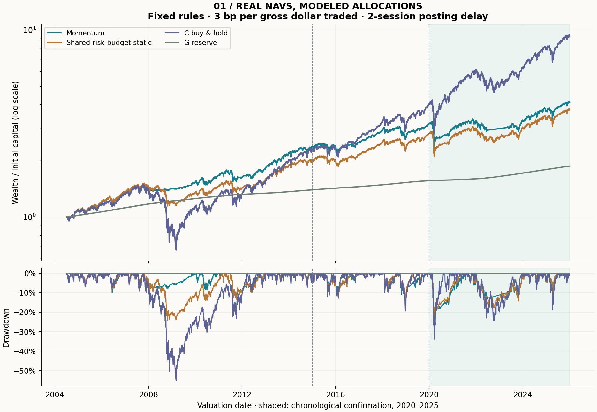

# Systematic Strategy Lab

Does a momentum signal improve multi-asset allocation after publication delays, trading costs and a matched risk-budget procedure? The main study models allocations using official public TSP fund NAVs, with a static control, C and G fund buy-and-hold references, and a funded account.

**Finding.** In the 2020–2025 historical confirmation window, momentum returned **30.69%** versus **33.97%** for the static control. Its annualized paired log-return difference was **−0.42 percentage points**, with a 20-session block 95% interval of **[−3.23, +2.33] percentage points**. The experiment did not establish a momentum advantage.

[NAV results](reports/real/REPORT.md) · [Methods](docs/METHODS.md) · [Run the NAV study](#run-the-nav-study) · [Research tracks](#research-tracks)



*Official public TSP fund share NAVs, 2003–2025. The chart shows hypothetical accounts and comparison fund holdings. The base model charges 3 bps per gross dollar traded, including the reserve leg.*

## Controls and implementation

The signal uses observations through t, reserves a full intervening NAV session for assumed publication and models a request at 11:00 New York time on t+2. The request posts at that session’s closing NAV under the ordinary-processing assumption. Momentum and the static control use identical risk scaling, costs and posting rules. The 63-session block interval also includes zero, and all nine predefined cost and delay scenarios produce a negative confirmation difference.

TSP accumulation NAV already reflects fund investment income and operating expenses, so the account adds zero separate dividends or fund expenses. The snapshot uses the current historical vintage and the release lag is assumed. [Timing and funded transfer](docs/WALKTHROUGH.md) · [Worked example](examples/explain_nav_transfer.py) · [Uncertainty](reports/real/uncertainty.png) · [Data rights](DATA_RIGHTS.md)

## Research tracks

### Asset allocation and signals

- **ETF dual momentum.** [WRDS replication report](reports/dual-momentum/REPORT.md) documents the cash gate, ranking and execution controls, including the REM distribution-adjustment discrepancy. Consult its data and reproduction notes for access boundaries.
- **Robust allocation.** [Methods](docs/ALLOCATION_RESEARCH.md) and [synthetic results](reports/allocation-synthetic/REPORT.md) cover six allocation families and sensitivity to return views under shared constraints. [Chinese notes](docs/ALLOCATION_LEARNING_CN.md) · [Provenance](docs/ALLOCATION_PROVENANCE.md) · [Validation](docs/ALLOCATION_VALIDATION.md)
- **Regimes and trend.** [Methods](docs/REGIME_RESEARCH.md) and [synthetic results](reports/regimes-synthetic/REPORT.md) compare causal HMM filtering, matched EMA/Kalman controls and volatility sizing. [Chinese notes](docs/REGIME_LEARNING_CN.md) · [Provenance](docs/REGIME_PROVENANCE.md) · [Tests](tests/test_regimes.py)
- **Breakout transfer.** [Methods](docs/BREAKOUT_RESEARCH.md) and [synthetic results](reports/breakout-synthetic/REPORT.md) hold the HMM fixed while separating the channel signal, state gate and volatility sizing. [Chinese notes](docs/BREAKOUT_LEARNING_CN.md) · [Provenance](docs/BREAKOUT_PROVENANCE.md) · [Validation](docs/BREAKOUT_VALIDATION.md)

### Commodity curves and funding

The public results in this track use synthetic futures inputs. Follow the progression from [contract accounting](docs/COMMODITY_ACCOUNTING.md) and [input specifications](docs/COMMODITY_INPUTS.md) to [curve signals](docs/COMMODITY_RESEARCH.md). The [worked signal example](examples/explain_curve_signals.py) and [initial ledger report](reports/commodities/REPORT.md) show contract identity, delayed inputs and costs.

- **Exits and admission.** [Exit priority](docs/COMMODITY_EXECUTION.md) ([results](reports/commodity-exit-priority-synthetic/REPORT.md)), [staged retirement](docs/COMMODITY_STAGED_EXITS.md) ([results](reports/commodity-staged-exit-synthetic/REPORT.md)) and [paired entry/exit budgets](docs/COMMODITY_ADMISSION.md) ([results](reports/commodity-entry-budget-synthetic/REPORT.md)).
- **Stress and cash capacity.** [Post-admission stress](docs/COMMODITY_STRESS.md) ([results](reports/commodity-stress-synthetic/REPORT.md)), [joint shocks](docs/COMMODITY_JOINT_STRESS.md) ([results](reports/commodity-joint-stress-synthetic/REPORT.md)) and [cash-buffer admission](docs/COMMODITY_RESILIENT_ADMISSION.md) ([results](reports/commodity-resilient-admission-synthetic/REPORT.md)) retain failed exits, residual positions and collateral shortfalls.

### Intraday execution

[Intraday methods](docs/INTRADAY_RESEARCH.md) and [synthetic runs](reports/intraday-synthetic/REPORT.md) model quote-after-signal execution, displayed capacity, funding and failed closes. [Source evidence](docs/INTRADAY_EVIDENCE.md) and its [worked fixture](reports/intraday-evidence-fixture/REPORT.md) show how rounding can obscure quote order. The [source audit](docs/INTRADAY_SOURCE_AUDIT.md) and [ledger fixture](reports/intraday-data-fixture/REPORT.md) cover dated identity, distributions and a separate cash benchmark. The full licensed historical replay has additional evidence requirements.

## Run the NAV study

Use Python 3.12 from the repository root. Activate the virtual environment with `.venv\Scripts\Activate.ps1` in PowerShell or `source .venv/bin/activate` on macOS/Linux.

```bash
python -m venv .venv
# Activate the environment before installing.
python -m pip install -r requirements.lock.txt
python -m pip install --no-deps -e .
python -m pip check
python -m pytest -q tests
python -m strategy_lab --real --output local-runs/real
```

The command uses the bundled NAV snapshot offline after installation. Use a fresh output directory. The report includes individual years, funded ledgers, both interval lengths and all cost/delay scenarios. The [earlier synthetic accounting demo](reports/demo/REPORT.md) covers split units and delayed dividend payments.

[Validation](docs/VALIDATION.md) · [Attribution and AI assistance](docs/PROVENANCE.md) · [Technical discussion](docs/DISCUSSION.md) · [Research directory](https://github.com/Mingju-Zhang-CBS/Quant)
