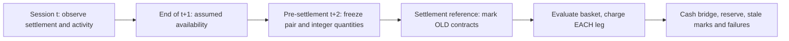

# Commodity curves — contracts before signals

**Stage 2 · eight-product accounting implementation · synthetic public results**

[Reproducible results](../reports/commodities/REPORT.md) · [Engine](../strategy_lab/commodities/engine.py) · [Tests](../tests/test_commodities.py) · [Input contract](COMMODITY_INPUTS.md) · [Data rights](../DATA_RIGHTS.md)

The research question is how a curve position survives contact with delivery,
transaction friction and a funded account. Before estimating carry or
basis-momentum, this module makes the underlying position and cash mechanics
inspectable. It extends this repository's fund-allocation work; the futures and
fund experiments have separate data contracts and separate evidence.

## Read the evidence in the right order

1. The public fixture generates **invented prices, contract identities, delivery
   dates and per-product calendars** for WTI, natural gas, gold, silver, copper,
   corn, CBOT soft red winter wheat and soybeans. Public unit conventions test
   dollars versus cents and contract multipliers. Its numerical P&L is not an
   empirical investment finding.
2. Private work has audited licensed WRDS/LSEG contract metadata and bounded
   observations. Coverage is not tradability; current-vintage metadata does not
   establish historical listing, specification or release vintages.
3. Full-history signals, frozen confirmation and statistical inference are
   subsequent research gates. This stage makes **no commodity alpha claim**.

## One information set, several clocks



The input has explicit offset-bearing UTC timestamps for observation availability,
the common daily decision and each product's local settlement mapped to UTC.
Each product supplies its own sessions; a generic weekday calendar is not an
exchange history. The decision uses the exact observation **two supplied local
sessions earlier**, which must already be available, and the latest metadata
version known before the decision and effective at execution. The public fixture
uses a full intervening session for availability. An older quote is not silently
substituted for the required observation.

Targets do not use that day's settlement, volume or future metadata revisions.
The later settlement and observed zero/missing activity can reject a modeled
execution; they cannot resize a frozen request to improve its outcome. Daily
marking is retrospective accounting, not a reconstruction of real intraday
clearing calls. A revised historical settlement may change this retrospective
ledger without changing decisions made before its availability.

## N1/N2 and safe rolling

N1 and N2 are the two earliest distinct delivery maturities that pass evidence,
listing, lagged-price and activity checks. Selection never maximizes future volume
and never requires delivery year to equal observation year. Duplicate economic
maturities are quarantined instead of becoming two artificial legs.

The risk boundary is the earliest supplied first-position, first-notice and last-
trade date. Notice and last-trade dates and verified boundary evidence are
required. Exit by the **fifth supplied exchange session before that boundary**;
do not open a new position on the exit date. A ten-session buffer is a fixed
control. Calendar coverage and its known-at/verified flags must cover the exit
calculation. These flags assert upstream documentary checks; the engine cannot
authenticate an exchange calendar merely by reading a boolean.

On the exit date the old pair is replaced by the next safe pair. Every changed
contract is a separate leg. An old short N2 becoming a long N1 trades **two**
contracts. A missing reference or inadequate capacity rejects the entire proposed
basket, leaving the old position marked and visible. Still held at its exit
deadline means **failed safe exit**, not a successful path silently omitted.
The all-or-none basket assumption excludes legging risk; it is not a promised
calendar-spread market fill. Historical position limits, limit-up/down locks,
order priority and broker-specific restrictions are not reconstructed.

## Units, prices and cash

|Product|Physical units per contract|USD per raw vendor unit|Outright tick in USD/unit|USD per tick|
|---|---:|---:|---:|---:|
|WTI|1,000 barrels|1|0.01|10|
|Natural gas|10,000 MMBtu|1|0.001|10|
|Gold|100 troy oz|1|0.10|10|
|Silver|5,000 troy oz|1|0.005|25|
|Copper|25,000 lb|1|0.0005|12.50|
|Corn / SRW wheat / soybeans|5,000 bushels|0.01|0.0025|12.50|

These are current public specifications used as fixture conventions, **not a
certified historical specification archive**. Silver settlement increments can
be finer than outright ticks: slippage uses the latter, and settlement is not
rounded onto the outright grid. See [CME sources](#sources).

For signed old quantity q, multiplier M and USD-converted settlement F:

```text
variation margin = q_old × M × (F_today − F_last_verified_mark)
leg cost = abs(delta_q) × (2.50 USD + slippage_ticks × outright_tick × M)
closing equity = opening equity + variation margin − all leg costs
model reserve = reserve_rate × gross_budget_proxy
free cash = closing equity − model reserve
```

No futures notional is paid at entry. Slippage is a separate cash debit; it is
not also embedded in the reference price. No dividend or extra interest is
added. New positions begin at their own settlement references. Selling an old
contract at 70 and buying a new contract at 73 is **not** a $3 loss or profit.
Actual roll economics emerge from later same-contract price changes and fees.

**Hand calculation, invented WTI spread:** start with $1,000,000; buy one near
at 70, sell one far at 72. Two entry legs cost 2 × (2.50 + 10) = $25, leaving
$999,975 equity. Near rises to 71 and far to 72.40: variation margin is
1,000 × (1 − 0.40) = $600. Closing both legs costs another $25: final equity is
$1,000,550. A 10% model reserve on the initial $142,000 gross proxy encumbers
$14,200; it is not a second $14,200 loss. The price *difference* is not charged
again on close. The original fixture generator uses different prices and thus
different P&L; this is a separate arithmetic example.

## Funding, risk and liquidity controls

- Initial capital $1m; fixed one-contract near/far requests are an **accounting
  diagnostic**, not a fitted signal. Both legs use the same integer quantity.
- At most 10% annualized forecast dollar risk relative to latest marked equity,
  using up to 252 common valid daily changes and at least 126. Per-contract
  changes use adjacent local sessions; gaps are not zero-return days. This
  stage scales fixed requests down, without claiming a production risk allocator.
  The later signal study still requires its planned equal-risk allocation.
- The gross budget proxy per leg is quantity × multiplier × the greater of
  current absolute mark and trailing 60-observation median absolute price.
  It survives negative/near-zero settlements. Gross ceiling: 3× equity.
- Reserve: 10% of that gross, no spread offset, at most 50% of equity. The
  predeclared stress is 20%. **This is not historical SPAN, actual initial or
  maintenance margin, or a broker's collateral policy.** No external credit.
- Known activity gate: required lagged price, positive lagged volume, OI ≥100;
  changed quantity ≤ floor(1% of lagged volume). These fixed assumptions are
  capacity scenarios, not fill estimates. Missing or zero execution-day volume
  also rejects a fill; positive volume does not prove settlement executability.
- Funding is checked again after marks and fees. A new basket can be rejected,
  but its quantities cannot be conveniently resized with the execution price.
  A mark-driven breach is logged and reduction sought at the next feasible
  decision; liquidation is not instantaneous or free.
- Missing marks retain the last verified price **with a stale flag**; the next
  valid mark catches up dollar P&L. Cash/NAV at stale marks is provisional.
  Nonpositive equity stops the funded path, without replenishment or continuing
  percentage-return calculations. Open positions remain visible at the horizon;
  terminal liquidation is not invented.

The daily decision currently shares one UTC timestamp across products active on
the date, before all their settlement clocks. Products closed that date retain
their positions. Closed-market risk cannot be assumed instantly reducible.

## Reproduce and inspect failures

```bash
python -m pytest tests/test_commodities.py
python -m strategy_lab.commodities --fixture --output local-runs/commodity-audit
```

The command generates every predeclared synthetic cost/buffer/reserve control and
single-product negative-price, missing-reference, low-capacity, unverified-calendar,
failed-exit and insolvency case. See the report's complete table, not a selected
winner. Each case retains contract decisions, trades, holdings, ledger and events.
The run manifest fingerprints the normalized inputs, protocol, source and outputs.
The TSP and legacy commands retain their original behavior.

Implementation and automated experiments are AI-assisted. Portfolio direction
was selected by Mingju Zhang; unaided human mastery is not inferred from a run.
No original employer, course or recruiting code is included. These new checks
exercise accounting and temporal invariants; passing them does not establish
historical tradability or profitability.

## Sources

Current contract rules: [WTI](https://www.cmegroup.com/rulebook/NYMEX/2/200.pdf),
[natural gas](https://www.cmegroup.com/rulebook/NYMEX/2/220.pdf),
[gold](https://www.cmegroup.com/rulebook/COMEX/1a/113.pdf),
[silver](https://www.cmegroup.com/rulebook/COMEX/1a/112.pdf),
[copper](https://www.cmegroup.com/rulebook/COMEX/1a/111.pdf),
[corn](https://www.cmegroup.com/rulebook/CBOT/I/10.pdf),
[SRW wheat](https://www.cmegroup.com/content/dam/cmegroup/rulebook/CBOT/II/14/14.pdf),
[soybeans](https://www.cmegroup.com/rulebook/CBOT/I/11.pdf).
[CME margin explanation](https://www.cmegroup.com/education/courses/introduction-to-futures/margin-know-what-is-needed)
distinguishes collateral from purchasing an underlying asset. Licensed data
handling follows [WRDS policy](https://wrds-www.wharton.upenn.edu/pages/about/data-download-and-analysis-policy/)
and applicable institutional/vendor agreements, not a presumed open-data grant.
