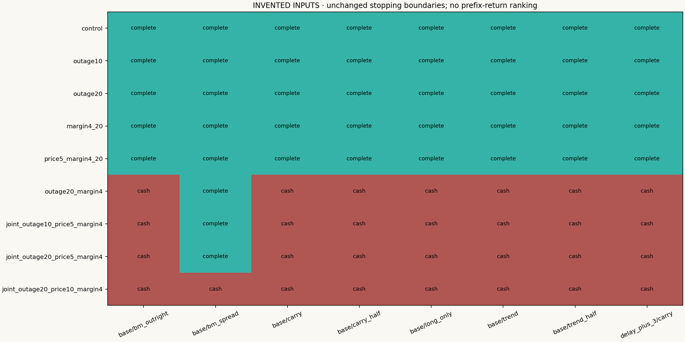
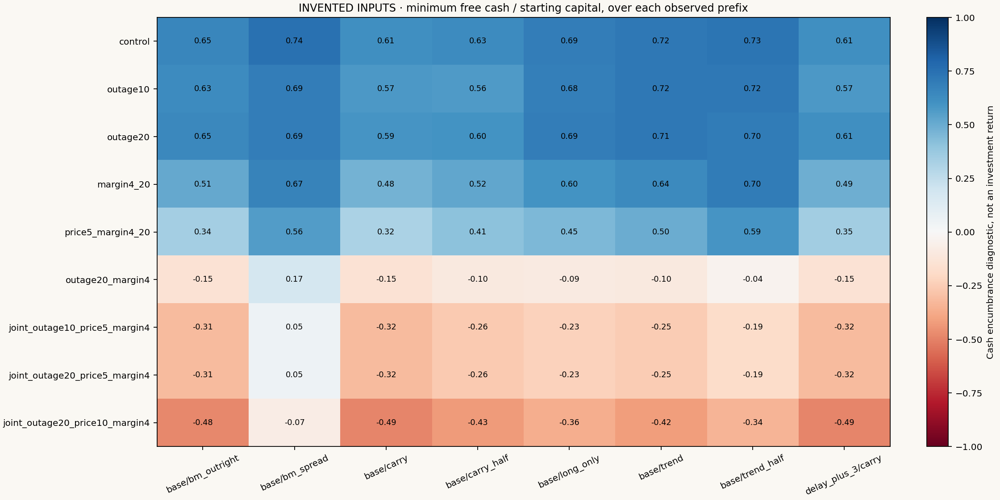
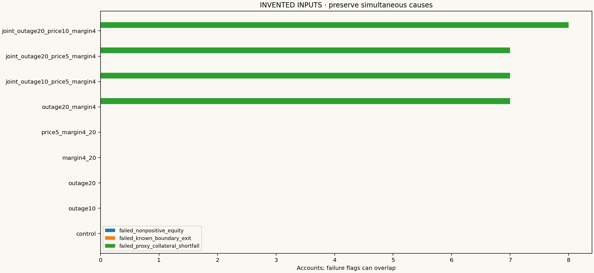

# When the exit budget runs out

**Research question.** Can a position admitted using recent liquidity still be
retired when supply disappears for longer, prices move against its original
direction and collateral is raised at the same time?

The [previous five-session study](COMMODITY_STRESS.md) remains unchanged. This
extension fixes longer outages and adverse price steps before calculating results.
Its object is **exit feasibility and cash sufficiency**, not a better backtest.

[All 72 invented results](../reports/commodity-joint-stress-synthetic/REPORT.md)
· [Executable experiment](../strategy_lab/commodities/joint_report.py)
· [Tests](../tests/test_commodity_joint_stress.py)

## 1. Fixed experiment, not a search for profitable parameters

Seven funded accounts and a delayed-carry account receive nine fixed scenarios:

| Scenario | Offered supply | Window, scheduled sessions | Gross reserve rate | Price step |
|---|---:|---:|---:|---:|
| Control | unchanged | 0 | 10% | none |
| Outage 10 | zero for both legs | 10 | 10% | none |
| Outage 20 | zero for both legs | 20 | 10% | none |
| Collateral only | unchanged | 20 | 40% | none |
| Price + collateral | unchanged | 20 | 40% | 5% |
| Outage + collateral | zero for both legs | 20 | 40% | none |
| Joint 10 | zero for both legs | 10 | 40% | 5% |
| Joint 20 | zero for both legs | 20 | 40% | 5% |
| Joint 20, larger price step | zero for both legs | 20 | 40% | 10% |

Event dates and contract IDs come from each unchanged control's first actual
addition of risk per product/year. Freeze these cohorts before running the stress.
Also freeze the signed **post-addition baseline inventory** on each leg and the
last valid absolute USD/physical-unit settlement available through entry day d−2.
The source timestamp accompanies every anchor. A zero anchor remains zero; an
unavailable anchor is rejected rather than invented.

Supply and collateral windows start the next scheduled session. Supply overlaps
use the minimum fraction; reserve overlaps use the maximum multiplier, not a
product of multipliers. The portfolio-wide rate applies to all positions while
any reserve window is active. Both price magnitudes and durations are assumptions,
without occurrence probabilities or market calibration.

## 2. A price shock with an explicit clock

For leg j, the permanent additive step is

`step_j = −sign(frozen baseline quantity_j) × fraction × frozen absolute USD anchor_j`.

Apply it from the next session onward. Repeated steps add. **The price offset does
not disappear when liquidity returns**: such a rebound would mechanically restore
some losses. Missing references remain missing, and negative prices are allowed.
There is no price floor or fabricated quote on an unavailable source day.

The current settlement surprise enters EOD VM and execution, after that morning's
request is frozen. Only lagged shocked prices can enter the funding price basis.
Historical signal directions, contract selection and unit-risk histories remain
on the original tape. Cash, collateral and changed funding can alter quantities.
This is a **conditional fixed-policy stress**, not a fully re-estimated strategy.

The shock follows the frozen baseline side, even if the stressed account later
holds less, holds the opposite side or holds nothing. It is not flipped to force
a loss. Each account therefore has its own adverse world: no cross-strategy alpha,
shared-market benchmark premium or p-value is inferred from these scenarios.

## 3. Why a paired spread can still need cash

An invented example: long two near contracts and short two far contracts, each
with a 100-unit multiplier and a USD 50 anchor. A 10% adverse step lowers the near
reference by 5 and raises the far reference by 5. On unchanged inventory, VM is
`2 × 100 × (−5) + (−2) × 100 × 5 = −2,000 USD`.

This is **basis deformation**: a parallel fall in both contracts would have a
different effect. The report's hypothetical full-baseline-leg impulse is a
scenario specification, not actual account P&L; only held exposure earns VM.

Suppose cash then equals USD 9,000 and gross proxy exposure is USD 30,000. A 40%
reserve requires USD 12,000, leaving a USD 3,000 collateral shortfall. Reserve is
encumbered cash, not an additional loss: `equity = opening equity + VM − costs`
and `free cash = equity − reserve`. A 50% risk-buffer breach triggers a reduction
request; it does not alone establish a collateral shortfall.

## 4. Keep the exit, pair and cash tests separate

Admission still uses five lagged capacity observations and the full proposed
target. Passing it reserves no future volume. At execution, cumulative closing
and opening sides share one daily allowance. Paired reductions use equal integer
units bounded by the weaker leg; zero supply on either leg blocks the pair.
Optional additions are checked against both day-start inventory and the stricter
planned post-reduction inventory, retaining the v0.7.1 correction.

The original hard delivery boundary is unchanged. No deadline extension, cash
top-up, naked-leg rescue or unobserved liquidation closes a failed path. Preserve
every simultaneous failure flag:

- nonpositive equity;
- remaining position at its hard exit boundary;
- EOD proxy reserve greater than available cash.

The existing engine selects a primary stop reason; `all_failure_flags` and the
events retain overlapping causes. `terminal_inventory.csv` records residual
quantities, shocked marks, original references, price offsets, deadlines, full
offered capacity, already used sides and remaining allowance. Independent
fill-to-cash reconciliation must value open positions with **shocked terminal
marks**, rather than combining shocked fills with original terminal prices.

## 5. Read results as diagnostics







The invented demonstration has **43 completed and 29 stopped paths**. These are
constructed-input outcomes, not real futures results. Different stopping dates
produce different observed prefixes: minimum free cash, worst daily VM and peak
shortfall describe those prefixes. Ending wealth is not used to rank strategies
or claim that one severity dominates another over a common horizon.

## Reproduce and inspect

```bash
python -m pip install -r requirements.lock.txt
python -m pip install --no-deps .
python -m pytest
python -m strategy_lab.commodities.joint_report --fixture --output local-runs/joint-stress
```

Choose a new output directory. Inspect `FROZEN_RUN.json`, `FROZEN_COHORTS.csv`,
`FROZEN_LEGS.csv`, `summary.csv` and `RUN_MANIFEST.json`. Account logs expose actual
fills, holdings/VM, admissions, exit plans, budgets, window exposure, signed price
events and terminal residuals. The compact packet preserves all summary paths,
all three figures and complete traces for selected controls and fixed scenarios;
the CLI generates every account trace.

Licensed work accepts `--input PRIVATE_DIRECTORY --cohorts PRIVATE_COHORT_CSV
--legs PRIVATE_LEG_CSV` instead of `--fixture`. Keep its inputs, anchors, dates and
all derived findings private. The source test suite and independently installed
Python 3.12 wheel each pass **128 tests**, including ten new joint-stress checks.

## Limits, rights and contribution

Scheduled calendars and current-vintage contract metadata do not reconstruct a
complete historical point-in-time archive. The reserve is a proxy, without
historical SPAN, spread credits, intraday calls or broker add-ons. EOD references
and assumed fees do not establish queue priority, actual close-out or executable
liquidity. A fixed outage is neither a probability model nor a worst-case bound.

Only original implementation, methods, tests and invented fixture outputs are
public. Licensed source data and real derived results are excluded. Mingju Zhang
selected the research direction; implementation, experiments and documentation
were AI-assisted. Unaided human review is tracked separately; automation is not
evidence of independently mastered implementation.

## Follow-up: fund the proposed position before admission

The [joint admission-buffer study](COMMODITY_RESILIENT_ADMISSION.md) links long-outage exit time and a portfolio-wide adverse-loss/collateral/fee/cash envelope. This original joint-shock baseline and every stopped path remain unchanged.
