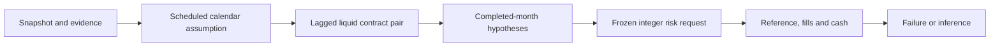

# Commodity curves: test the trading path before the premium

**Capacity revision:** [Paired staged exits](COMMODITY_STAGED_EXITS.md) reduces
old inventory in lagged-capacity slices and starts a predeclared retirement
schedule. All prior versions and failed outcomes remain separately inspectable.

**Execution revision:** [Exit-first protocol comparison](COMMODITY_EXECUTION.md)
separates mandatory reductions from replacement entries, adds a frozen
five-observation liquidity gate and monotone maturity selection. Run it with
`--policy persistent`; the default `legacy` and its original report remain
available. These are historical engineering comparisons, not fresh unseen OOS.

The exploratory runner connects contract evidence, monthly hypotheses and a
funded daily account. Public examples use **invented data**. A separately held
WRDS/LSEG snapshot workflow uses licensed real references; its data, per-contract
outputs and derived findings are private pending release rights. The existing
real TSP study remains a separate experiment.

```text
python -m strategy_lab.commodities.research_report --fixture --output local-runs/curves
python -m pytest tests/test_commodity_research.py
```

The full offline example runs eleven predefined scenarios and seven accounts
per scenario: five strategies and two half-funded comparison sleeves. The
[compact synthetic report](../reports/commodity-research-synthetic/REPORT.md)
contains illustrative results, not commodity investment evidence. The command
also writes complete ledgers, orders, failed requests, base holdings, decisions,
variation-margin attribution and source/configuration/code/output fingerprints.

## A research chain with distinct information clocks



|Step|Convention|
|---|---|
|Observe|Session t prices, volume and open interest|
|Assume available|After the next complete scheduled session ends in Chicago|
|Decide|07:00 Chicago on t+2, before the modeled EOD reference|
|Measure risk|Permitted price history and equity through t−2|
|Book|Old holdings receive their own contract's price change; changes incur costs|
|Earn|New holdings begin earning price changes after entry|

The rules calendar is independent of observed quote dates. It removes declared
New Year, MLK, Presidents Day, Good Friday, Memorial Day, Juneteenth from 2022,
Independence Day, Labor Day, Thanksgiving and Christmas patterns. Saturday New
Year does not remove the preceding Friday. The implementation uses pandas
holiday primitives; [calendar-library conventions](https://github.com/rsheftel/pandas_market_calendars/blob/master/pandas_market_calendars/calendars/cme.py)
were reviewed alongside [CME's hours](https://www.cmegroup.com/trading-hours.html)
and dated [2022 Juneteenth settlement evidence](https://www.cmegroup.com/tools-information/holiday-calendar/files/juneteenth-day-holiday-settlement-times-2022.pdf).
It is an **explicit scheduled-settlement proxy**, not a complete historical
notice archive. Unexpected closures, early settlement clocks and source date
label differences remain evidence gaps; off-calendar records are retained.

## Contracts, signals and risk are separate decisions

N1/N2 are the earliest distinct maturities with lagged prices, volume sufficient
for one integer contract at 1% participation, and OI at least 100. Listing and
observed unit intervals must cover the scope. Missing front notice/specification
evidence blocks the pair; a distant maturity is not silently promoted. The
earliest known first-notice/last-trade boundary has a five-session buffer, with
ten sessions as a predefined stress. Full first-position history is not
reconstructed, so this is not a delivery-risk certification.

The [signal definitions](COMMODITY_SIGNALS.md) retain long-only, twelve-month
trend, annualized curve carry, basis-momentum outright and a physical-unit
calendar spread. Monthly reference histories mark the **same selected contract
at both endpoints**; roll price gaps do not create returns. Every scheduled
interval is required for a complete month. These reference measurements do not
establish that all corresponding orders could have filled.

The [authors' 2016 manuscript](https://conference.nber.org/confer/2016/CEMf16/Boons_Prado.pdf)
uses compounded prior-year nearby/deferred returns (equations 11–12), but its
monthly maturity convention differs from this lagged-liquid daily selection and
known-boundary buffer. The eight-market implementation is an independent
extension, not an exact replication of the 2019 journal study.

For each requested outright or paired unit, use the last 60 valid dollar-P&L
observations, minimum 40. Initial standalone annual risk per active unit is
`10% × known equity / sqrt(number of active units)`. A trailing 252-session
covariance, minimum 126 common observations, scales combined forecast risk down
to 10%. Monthly changes or pair changes allow reallocation; intermediate
requests only reduce units. Insufficient risk evidence produces an explicit
zero request, without reranking signals. Cross-sectional sorts need six eligible
products and deterministic ties. Paired legs round together toward zero.

## Follow the account rather than the stitched chart

- Initial capital is $1m; capital continues across years and evaluation phases.
- Charge $2.50 per contract/side and one outright tick per changed leg. Separate
  0/2-tick and zero-friction controls retain the same modeled account rules.
- Reserve 10% of each leg's gross proxy, 20% in the stress; no spread credit.
  Reserve/equity is capped at 50%, gross/equity at 3×. Near-zero prices do not
  erase the gross budget: use the larger absolute mark and historical median.
- Positions do not pay notional principal. Variation margin and fees change
  equity; the reserve encumbers cash without a second expense. Cash yield is zero.
- In the original `legacy` protocol, product baskets are all-or-none independent-leg assumptions. Frozen requests
  can fail lagged capacity, missing references, actual-day activity or funding.
  They are not resized using execution-day prices.
  The declared product basket couples closes and replacement entries; a failed
  new entry can therefore block an otherwise feasible old close. This is a model
  limitation to diagnose, not proof that the outgoing market lacked liquidity.
  The separately versioned `split_only` and `persistent` policies close old
  product baskets before attempting replacement risk, without waiving exit checks.
- Missing held marks remain flagged and use the last verified mark until a new
  reference exists. Unfilled known-boundary exits or nonpositive equity stop the
  funded path. No replenishment, free liquidation or post-failure continuation.

Daily price moves can breach a modeled limit before a permitted reduction fills.
Breaches remain visible; an ex ante limit is not a guaranteed realized bound.
An independent telescoping identity adds trade-reference cash terms and marked
open holdings to reconcile terminal equity. This identity does not imply that
notional cash was actually paid at entry. EOD booking also does not reconstruct
intraday variation calls or cross-market settlement timing.

## Test the claims without discarding failures

The real protocol fixes development 2005–2014, review 2015–2019 and historical
confirmation 2020–2025, with 2000–2004 warmup. Earlier missing evidence remains
a gap rather than triggering a favorable later start. Confirmation is not a
prospective unseen-market claim.

The two primary claims compare BM outright with the sum of separately funded
$500k trend/carry sleeves, and BM spread with zero. The benchmark is not a daily
50/50 remix or free netting of trades. Paired, noncircular 6/12-month blocks use
5,000 draws, seed 20261026, percentile intervals, centered-null two-sided p-values
and Holm across two claims per phase/block. Incomplete/stale months are not
silently dropped. A failed required path makes the claim **not evaluable**;
that is different from a nonsignificant result. No funded exposure is not
reported as evidence of zero alpha.

Additional decision delays, a ten-session buffer and removal of each sector are
predefined diagnostics. Delay means a later signal decision with later permitted
risk inputs, not a fixed-order latency replay. Sector cases suppress requests
without reranking. Changes to costs may change integer holdings and later risk
budgets, so different terminal values need not be monotonic in assumed fees.

## Private snapshot interface and honest limits

```text
python -m strategy_lab.commodities.research_report --input PRIVATE_INPUT --output PRIVATE_OUTPUT
```

`PRIVATE_INPUT` contains `quotes.csv.gz` (contract, session, settlement, volume,
open_interest), `contracts.csv` (contract, product, delivery, first_notice,
last_trade, valid_from, valid_to, listed_from, multiplier, usd_scale,
outright_tick, unit_evidence), and `manifest.json` (data_kind, source, rights,
vintage, calendar_basis). The calendar basis must explicitly be
`authorized scheduled-settlement proxy`. Structure and evidence inputs are
normalized once; protocol checks occur at the account entry. Economic failures
are logged rather than swallowed by exception handlers.

Effective intervals in a current vendor snapshot do not establish original
publication timestamps. No-recorded-end assumptions need an explicit bounded
cutoff and provenance; contradictory intervals must be blocked, not repaired
from a contract name. Actual margins, broker add-ons, bid/ask history and SPAN
offsets are not supplied by this interface. See [data rights](../DATA_RIGHTS.md)
and [tests](../tests/test_commodity_research.py). Research design was selected by
Mingju Zhang; implementation and experiments were AI-assisted, with unaided
personal review tracked separately.
