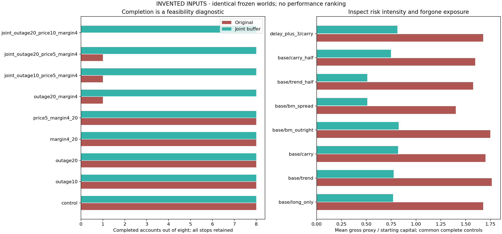

# Admit risk only when the exit and cash budgets agree

**Question.** What changes when a new futures position must fund its own exit
through a long liquidity outage, an adverse price deformation and a collateral
increase—without assuming that existing positions have already been closed?

The [joint-shock study](COMMODITY_JOINT_STRESS.md) remains the unchanged baseline.
This extension changes admission and early retirement under one fixed protocol.
It evaluates exit feasibility, cash gaps and forgone participation; it does not
select parameters for returns or assert that stress survival establishes alpha.

[Invented experiment](../reports/commodity-resilient-admission-synthetic/REPORT.md)
· [Implementation](../strategy_lab/commodities/admission_resilience.py)
· [Tests](../tests/test_commodity_resilience.py)

## Frozen assumptions

| Component | Fixed assumption |
|---|---|
| Outage allowance | 20 scheduled sessions without offered supply |
| Capacity | Minimum of five available lagged observations; weaker spread leg |
| Drain buffer | Original two scheduled sessions |
| Adverse move | 10% of the lagged absolute USD price basis, charged on gross legs |
| Reserve scenario | At least 40% of gross after a 10% absolute-price increase |
| Transaction-cost allowance | Two sides per envelope unit, plus old closing sides on same-contract reversals |
| Unallocated cash | 10% of available admission cash |
| Stress comparison | Same nine scenarios, eight accounts and original fixed cohorts |

These are declared hypotheses, not estimated exchange margins, gap probabilities
or an industry-standard risk limit. The original five-session and joint-shock
baselines, including failed paths, are preserved.

## 1. Leave enough time to stop trading and still retire the position

Let `U` be the **full proposed post-trade integer quantity**, `C` the conservative
lagged capacity and `R` the scheduled sessions after entry through the original
hard exit date. For a spread, use the weaker leg's capacity and earliest deadline.
Require the original lead rule and

`C > 0` and `R > 20 + ceil(U / C) + 2`.

The entry day is excluded. A proposal of 12 units at capacity 3 needs four drain
sessions: `R = 26` is refused, while `R = 27` clears this time inequality.
Retirement starts earlier using the same allowance and **remaining held units**:
remaining inclusive sessions at or below `20 + ceil(held / C) + 2`, or an existing
retirement condition, latches a paired exit goal. Zero known capacity starts
retirement immediately. The hard delivery boundary itself never moves.

Passing this test does not reserve future volume. A longer outage, missing quote
or persistent post-outage capacity collapse can still prevent exit.

## 2. Give the entire portfolio one cash budget

At the morning decision, available cash is

`B = min(recorded equity through d−2, the account's own prior-EOD cash)`.

The account knows its previous fills and cash; today's VM, reference price and
offered supply are not yet used. The current announced reserve rate is known.
The funding basis uses only prices through d−2: the greater of the last absolute
USD price and the median of the most recent 60 valid absolute observations.

Before rounding to contracts, one closed-form cap limits the continuous target:

`scale <= 0.90 B / [(0.10 + max(0.40, current reserve rate) × 1.10) × G_target + 2 F_target]`.

Here `F_target` is the one-sided unit-fee allowance. The original sizing limits
also apply. No repeated search for a target, optimized cash threshold or
return-dependent parameter adjustment is used.

After the time/liquidity checks, construct one per-leg exposure envelope:

`envelope_j = max(abs(day-start holding_j), abs(proposed post-exit target_j))`.

Old and replacement contracts both remain in this envelope. An expected exit
does not release collateral or pay for another entry. Let

`G = sum(envelope_j × multiplier_j × lagged price basis_j)`.

Then calculate:

- adverse VM allowance `L = 0.10 G`;
- stressed reserve `M = max(0.40, announced reserve rate) × 1.10 G`;
- round-trip fee allowance `F = 2 × sum(envelope_j × one-sided unit cost_j)`;
- retained cash buffer `H = 0.10 B`.

On a same-contract sign reversal, add
`min(abs(day-start holding_j), abs(proposed target_j)) × unit cost_j` to `F`.
The old close, new entry and eventual new exit can require three sides; a
two-sided max-absolute envelope alone does not cover that transition.
More generally, let `O`, `S`, `N` be day-start inventory, the planned reduced
inventory and proposed target. The fee-side allowance for each leg is at least
`abs(S−O) + abs(N−S) + abs(N)`, covering reduction, addition and eventual exit.
Keep both this bound and the original `2 × envelope` plus reversal allowance.
This also covers a same-direction deep reduction followed by a readdition.

Admit optional additions **together** only if `L + M + F + H <= B`.
This is one portfolio inequality, rather than a fresh allowance for each product.
If it fails, reject the optional additions and retain the already frozen old-risk
reductions. A separate existing-only deficit shows when held risk already exceeds
the assumed budget. Refusal is not itself insolvency or an executed liquidation.

Charging two fee sides on old exposure is deliberately conservative: actual
daily costs are still debited only for executed sides. No hypothetical VM loss,
reserve allowance or cash buffer is posted as a new ledger expense.
The reversal surcharge was fixed as an accounting correction before rerunning
the final experiment. Earlier local outputs were preserved; fee rates and every
stress magnitude stayed unchanged.

## 3. Numerical example: paired does not mean cash-free

Long two near contracts and short two far contracts, each with a 100-unit
multiplier and USD 50 price basis, create USD 20,000 of gross envelope exposure.
With USD 20,000 available cash and a USD 5 one-sided fee per contract:

| Requirement | USD |
|---|---:|
| Adverse loss allowance | 2,000 |
| Stressed reserve | 8,800 |
| Round-trip fees | 40 |
| Retained cash | 2,000 |
| Total | 12,840 |
| Remaining scenario slack | 7,160 |

Both legs are charged because the adverse deformation can move against each
side. Gross collateral has no assumed spread credit. In a different portfolio,
two products can each pass against USD 10,000 when checked alone and fail when
checked together; spending that cash twice would be an admission error.
If this same spread is instead being reversed from an equal opposite position,
include USD 20 for the old closing sides: the fee allowance is USD 60 and the
total cash requirement becomes USD 12,860.
For another invented example, reducing 12 units to1 and reopening to11 requires
11 closing +10 reopening +11 eventual-exit sides =32, above the original
24-side envelope. The budget retains the larger32-side requirement per leg.

## 4. Compare against the same adverse worlds

The stress dates, contract identities, frozen baseline sides and USD anchors
come from the original ungated reference, including in the synthetic CLI.
They are not regenerated from the protected policy's trades. If the gate avoids
exposure on a scheduled shock date, record that fact instead of moving the shock.

Keep all nine cases and all eight accounts. Compare completeness, stop causes,
cash gaps, residual pairs, time/cash refusals, exposure and trades forgone. Different
stopping dates and account-specific adverse worlds preclude cross-strategy alpha
claims or a common-market performance ranking. A no-qualified-trades result must
remain visible; cash preservation through inactivity is not strategy success.



On **invented inputs**, the original policy has 43 completed and 29 stopped paths;
the joint buffer completes all 72. Both use identical original event tables.
This constructed result is not a licensed real-reference finding or proof of
general safety. The second panel uses only complete, common-horizon controls to
show risk intensity; it does not compare returns of differently stopped prefixes.
The summary CSV retains time refusals, portfolio cash-refusal days and existing
deficits alongside actual fills and stops. Inspect these opportunity costs before
interpreting a green completion chart.

## Reproduce and inspect

```bash
python -m pip install -r requirements.lock.txt
python -m pip install --no-deps .
python -m pytest
# Original joint-shock baseline
python -m strategy_lab.commodities.joint_report --fixture --output local-runs/joint-baseline
# Same baseline-derived events, protected admission and retirement
python -m strategy_lab.commodities.joint_report --fixture --joint-buffer --output local-runs/joint-buffer
```

Choose new output folders. The flag is opt-in; the old policy is unchanged.
Inspect `resilience_entries.csv.gz` for full targets, weaker capacity, deadline
and outage-adjusted slack. `resilience_budgets.csv.gz` records every morning's
available cash, envelope identities/units, gross, adverse loss, reserve, fee
allowance, cash buffer, portfolio decision and existing-only deficit. Connect
these to actual admissions, fills, VM, holdings, exit plans, terminal inventory,
all failure flags and the run/source/output fingerprints.

The complete suite contains **146 tests**, including 18 new checks. Independent
installation and raw-source reconstruction examine portfolio cash reuse, expected
exit credit, full-target time budgets, paired retirement and causal clocks.
See [validation](VALIDATION.md) for the final reproduction record.

## Limits, rights and contribution

This is a **single assumed deformation envelope**, not a bound on natural
multi-day changes, repeated shocks, unlimited gaps or a calibrated liquidity
model. Day-start inventory can differ from lagged market information. A fixed
cash margin cannot guarantee future collateral or executable liquidation.
The scheduled-calendar proxy, current-vintage contract metadata and incomplete
historical first-position evidence remain. The gross reserve is not historical
SPAN, actual broker margin, intraday calls or a model of spread credits.

Licensed raw data, real cohorts/anchors and all real-derived findings remain
private. Public material contains original code/methods/tests and invented
experiments only. Mingju Zhang selected the research direction; implementation,
experiments and documentation were AI-assisted. Unaided review is tracked
separately. No employer code, actual trading performance or undisclosed data is
represented by this independent public demonstration.
