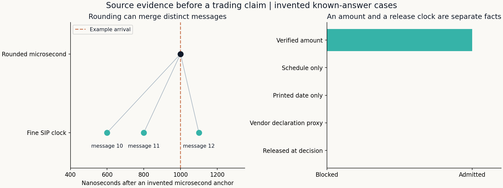

# Resolving an Observation Is Different from Improving a Strategy

**Question:** does the source establish what was available before a decision?

[Worked example](../reports/intraday-evidence-fixture/REPORT.md) · [Implementation](../strategy_lab/intraday/evidence.py) · [Tests](../tests/test_intraday_evidence.py) · [Original source audit](INTRADAY_SOURCE_AUDIT.md)

## Recover precision before comparing clocks

A SIP record can store a microsecond timestamp and a separate nanosecond remainder.
Comparing only the first field with a derived table can create an apparent clock
disagreement. Recover the full clock as `microsecond timestamp + remainder`;
never add the remainder twice or infer it from a price move.

The cluster check requires exact asset, price and share-quantity correspondence,
explicit dated lot units and a unique match for each coarse tuple. Fine timestamps
must lie strictly inside the coarse label's half-microsecond neighborhood. A tie
at 500 ns is left unresolved. Message sequences are checked inside a single source
scope, not compared indiscriminately across feeds. Distinct fine messages can then
explain a collision under rounding; this does not establish an undocumented vendor
algorithm or authenticate the original feed.

Recovered observations retain their fine time. The existing execution engine must
still check arrival and expiry. A rounded quote at the arrival boundary might
actually have preceded the request. Restoring order does not authorize a new fill
window, extra child orders, more displayed capacity or an account restart.

Unmatched clusters remain in an audit table. Keep the original coarse file, raw
fine messages, conversion evidence and recovery output as separate artifacts.
An old stopped account remains an old stopped account even if a later source
exception is repaired.

### The raw NBBO file is not the only eligible source

The [NYSE Daily TAQ specification](https://wrds-www.wharton.upenn.edu/documents/1967/Daily_TAQ_Client_Spec_v4.0.pdf)
distinguishes NBBO appendages from quotes that themselves establish the new
national best bid and offer. A CQM venue quote can supply both sides **only**
under that explicit self-NBBO indicator: UTP source `N` uses `4`; CTA source `C`
uses `1` before 30 October 2017 and `G` from that transition. Ordinary venue
quotes and one-sided changes cannot fill a missing national quote. The document
also records changes to NBBO-file inclusion; file coverage is vintage-dependent.

`select_quote_sources` retains every input decision. It collapses cross-file
copies only when clock, sequence and complete quote payload agree; conflicting
copies are quarantined. It never adds the displayed quantities of duplicate
messages. `recover_quote_clusters` then applies the original exact-tuple and
clock gates. Selection of a source alone is insufficient to restore a cluster.

Some dated master records expose the complete `symbol_15` while root/suffix are
absent. `resolve_dated_lots` permits the **exact** full symbol in that case, with
the same-day lot field. It does not match prefixes, choose between conflicting
units or borrow a lot size from an adjacent date. The licensed source-to-quote
map remains private; the [source-selection example](../reports/intraday-evidence-fixture/REPORT.md#which-source-may-supply-the-missing-observations)
is invented.

## A distribution schedule is not an amount release

Record security identity, **US** ex-date, gross currency/amount per share,
document fingerprint, source, release timestamp/timezone and correction status.
Separate evidence of the calendar from evidence of the amount. Net receipts after
withholding do not replace the gross distribution used for a price adjustment.

For example, the issuer's [September 2025 schedule](https://www.invesco.com/content/dam/invesco/hk/en/pdf/Q3-2025-distribution-announcement-20250910-EN.pdf)
specifies Hong Kong dates and says that a later announcement will provide the
amount. Its [amount document](https://www.invesco.com/content/dam/invesco/hk/en/pdf/third-quarter-distribution-announcement-20250921-EN.pdf)
is dated 21 September and gives USD 0.69395 per share. The title names the third
quarter, while one body sentence names the second; the [issuer's exchange form](https://www1.hkexnews.hk/listedco/listconews/sehk/2025/0921/2025092100033.pdf)
identifies the third-quarter distribution. Preserve the inconsistency rather than
silently editing the source. The [US issuer history](https://www.invesco.com/us/en/financial-products/etfs/invesco-qqq-trust-series-1.html)
lists the US ex-date as 22 September. Those sources support identity, amount and
calendar distinctions; a printed date or a current page alone does not establish
the exact historical publication timestamp.

### A release listing can strengthen the evidence

The [official HKEX QQQ announcement search](https://www1.hkexnews.hk/search/titlesearch.xhtml?category=0&from=20250101&lang=EN&market=SEHK&stockId=1000249048&t1code=10000&t2Gcode=3&t2code=13250&to=20251231)
now provides a separately checked release listing for these amount documents.
Times below are interpreted in Hong Kong local time; the linked documents
identify the same trust and USD distribution per share across trading counters.

| Distribution | USD/share | Listed release, Hong Kong time | Amount document |
|---|---:|---|---|
| 2025 Q1 | 0.71571 | 23 March 2025, 19:00 | [Issuer announcement](https://www1.hkexnews.hk/listedco/listconews/sehk/2025/0323/2025032300173.pdf) |
| 2025 Q2 | 0.59111 | 22 June 2025, 18:31 | [Issuer announcement](https://www1.hkexnews.hk/listedco/listconews/sehk/2025/0622/2025062200033.pdf) |
| 2025 Q3 | 0.69395 | 21 September 2025, 18:29 | [Issuer announcement](https://www1.hkexnews.hk/listedco/listconews/sehk/2025/0921/2025092100031.pdf) |
| 2025 Q4 | 0.79408 | 22 December 2025, 06:10 | [Issuer announcement, DOCX](https://www1.hkexnews.hk/listedco/listconews/sehk/2025/1222/2025122200011.docx) |

The listing has **minute** precision. Use the next minute boundary as a
conservative availability upper bound, convert to UTC, and compare strictly
with the actual US decision. Q4 illustrates why a Hong Kong release date can
correspond to the preceding New York calendar date. Keep the printed document
date, vendor declaration date, exchange release and US ex-date in separate
fields. Never overwrite the original vendor date to manufacture agreement.

This is stronger retrospective publication evidence for the matched events;
it is not an independently archived snapshot of the page as originally served,
proof of a participant's feed receipt, or evidence for every earlier dividend.
Unresolved earlier events and original stopped accounts remain binding.

`evaluate_action_evidence` checks an analyst-verified primary release clock
strictly before the supplied decision. Date-only documents, schedules, unmatched
amounts and releases at or after the decision cannot clear that strict check.
It validates attestations; it cannot independently verify their truth. Save the
source document and release listing, not merely a boolean flag.

The original action adapter's prior-day declaration-date convention remains an
explicit **current-vintage end-of-day proxy**. A matching alternate vendor date
may be evaluated under that same convention in a separately recorded overlay;
it must not be relabeled as a verified primary publication timestamp. Missing
or same-day dates remain unavailable before the open without additional evidence.

### A declaration date is a different kind of evidence

Keep two assessments separate: a primary amount-release clock and a
current-vintage declaration-date sensitivity. The original prior-day proxy may
use an alternate vendor record only after a unique date-effective security link,
the same US ex-date, exact gross cash amount, currency, distribution components
and adjustment factors have been verified. Record the original field and the
alternate source separately. A proxy does not become a primary release timestamp
because it precedes the ex-date, and it does not prove archived point-in-time data.

Matching must preserve the frozen precision rule. In an **invented** example,
USD 0.12345 and a second vendor's four-decimal USD 0.1234 are not an exact amount
match. Do not round the first value, select a tolerance after seeing matches or
copy a date from the nearest event. Record the precision difference and seek
additional evidence. Missing declaration dates remain missing even when the
cash amount itself agrees. The [invented publication example](../reports/intraday-evidence-fixture/REPORT.md)
now includes an earlier vendor-date proxy that correctly fails the strict gate.

The [earlier trust prospectus](https://www.sec.gov/Archives/edgar/data/1067839/000110465915004817/a15-1379_1485bpos.htm)
describes a historical distribution calendar. It does not publish a later
quarter's cash amount or its release time. The issuer's [ETF tax center](https://www.invesco.com/us/en/accounts/tax-center/etf-tax-center.html)
distinguishes annually posted tax information from an estimated dividend calendar;
neither substitutes for the amount announcement's publication evidence.

An unavailable history page, unsuccessful archive query or missing vendor field
is an **evidence gap**, not proof that no announcement existed. Keep the query,
response and retrieval date. A newly found date proxy that occurs after an
account's original stopping point cannot justify restarting that account.

## What changes, and what stays fixed

Source adjudication changes a documented observation only when its evidence
passes. Signal definitions, costs, financing, latency, one-snapshot fills and stop
conditions remain frozen. Record adjudication before the corrected replay and
disclose that earlier results have already been seen. No new untouched holdout
is created by correcting historical data.

The licensed replay and its source map remain private. Public examples above are
invented; the issuer case uses linked public facts. No complete ten-year return,
Sharpe, significance result or realizable execution claim follows from the
evidence checks. Development and automated verification were AI-assisted.
