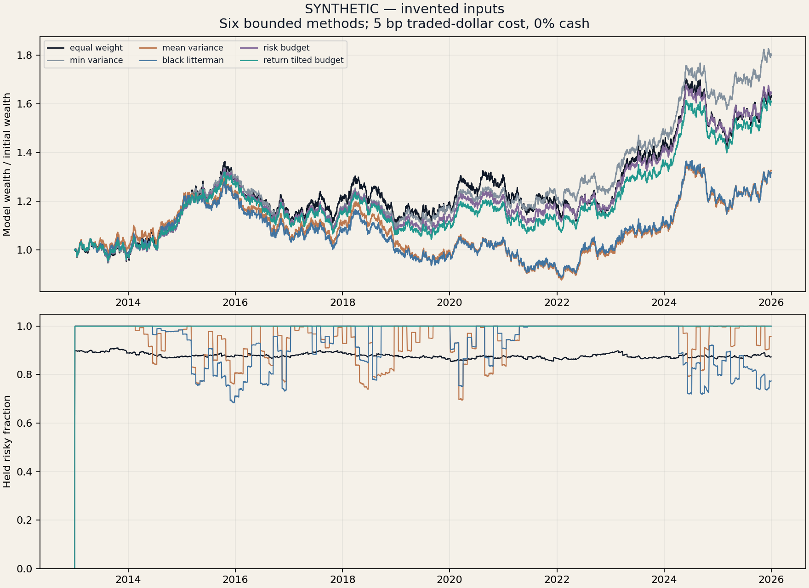
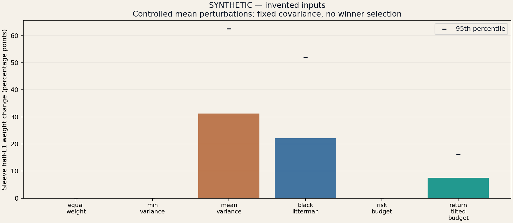
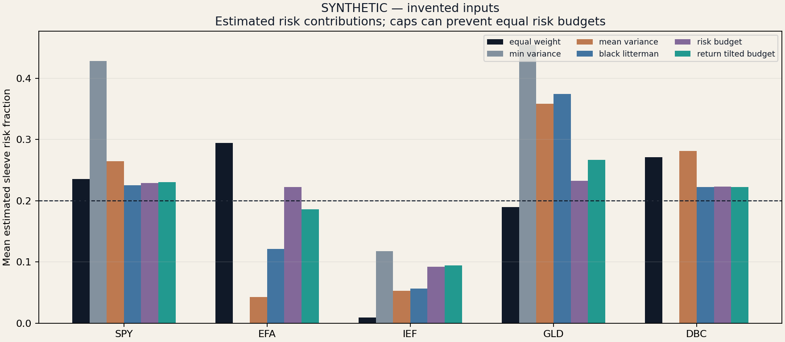

# Robust asset allocation — SYNTHETIC / INVENTED INPUTS

How do return-driven and risk-driven allocations respond to noisy forecasts, concentration limits and implementation costs?

Five ETF roles: SPY, EFA, IEF, GLD, DBC. Public results are invented; real adjusted-price research remains private. These are funded fractional total-return-unit accounts, not observed ETF shares or fills.

## Fixed comparison

Six primary methods share trailing data, 40% sleeve asset caps, a 10% target-volatility scaling rule, 21-session rebalancing and next-session-close execution. BL changes the mean, not the common covariance. Its prior is reverse-implied from an equal-weight reference, not historical market-cap weights. Return-tilted risk budgeting is a dimensionless convex RRP-inspired specification, not a replication of a uniquely defined canonical relaxed-RP model.

## Historical confirmation: 2021–2025

Base scenario: 5 bp per dollar traded, 0% assumed cash yield.

| Method | CAGR | Excess Sharpe | Max drawdown | Annual turnover | Held risky exposure | Effective risky assets |
|---|---:|---:|---:|---:|---:|---:|
| equal_weight | 4.35% | 0.48 | -16.72% | 0.26x | 87.4% | 5.00 |
| min_variance | 7.24% | 0.92 | -10.78% | 0.28x | 100.0% | 2.93 |
| mean_variance | 4.75% | 0.53 | -15.97% | 1.96x | 98.1% | 2.88 |
| black_litterman | 4.51% | 0.50 | -16.10% | 1.47x | 93.2% | 3.03 |
| risk_budget | 5.84% | 0.70 | -14.13% | 0.28x | 100.0% | 3.96 |
| return_tilted_budget | 5.91% | 0.71 | -13.34% | 0.31x | 100.0% | 3.83 |

## Predeclared paired comparisons

| Alternative minus control | Block sessions | Annualized paired arithmetic mean | 95% interval | Exposure difference |
|---|---:|---:|---:|---:|
| black_litterman minus mean_variance | 20 | -0.22% | [-1.31%, 1.11%] | -4.9% |
| black_litterman minus mean_variance | 63 | -0.22% | [-0.98%, 0.65%] | -4.9% |
| return_tilted_budget minus risk_budget | 20 | 0.06% | [-0.79%, 0.77%] | 0.0% |
| return_tilted_budget minus risk_budget | 63 | 0.06% | [-0.90%, 0.81%] | 0.0% |
| min_variance minus equal_weight | 20 | 2.54% | [-0.73%, 5.23%] | 12.6% |
| min_variance minus equal_weight | 63 | 2.54% | [-0.37%, 4.98%] | 12.6% |

These are 252 times aligned arithmetic daily-return differences, not CAGR differences. 20/63-session moving-block percentile intervals are descriptive, without multiplicity adjustment. Shared risk procedures need not create identical realized risk or exposure. Familiar historical windows are not independently unseen future evidence.

## Controlled forecast fragility

Covariance stays fixed while four date-seeded normal mean shocks are applied per rebalance. Their scale is an IID standard-error approximation used only as a declared stress size, not a confidence interval. Mean-independent methods intentionally have zero sensitivity in this test; that does not prove superior future returns.

| Method | Median sleeve half-L1 change | 95th percentile | Failed perturbations |
|---|---:|---:|---:|
| equal_weight | 0.00% | 0.00% | 0 |
| min_variance | 0.00% | 0.00% | 0 |
| mean_variance | 31.22% | 62.52% | 0 |
| black_litterman | 22.16% | 52.08% | 0 |
| risk_budget | 0.00% | 0.00% | 0 |
| return_tilted_budget | 7.59% | 16.29% | 0 |

## Risk budgeting and solver failures

Equal capital weights do not imply equal risk. A 40% asset cap can prevent exact equal-risk contributions; the risk-budget residual is reported rather than relabeling a constrained solution as exact risk parity.

| Primary method | Scheduled decisions | Failed decisions | Mean risk-fraction L2 error | Maximum optimality residual |
|---|---:|---:|---:|---:|
| equal_weight | 162 | 0 | 0.2281 | 0 |
| min_variance | 162 | 0 | 0.4522 | 7.07e-08 |
| mean_variance | 162 | 0 | 0.5157 | 2.7e-07 |
| black_litterman | 162 | 0 | 0.4682 | 3.09e-07 |
| risk_budget | 162 | 0 | 0.1206 | 1.25e-06 |
| return_tilted_budget | 162 | 0 | 0.1588 | 2.2e-06 |

Failures request all cash until the next scheduled rebalance; execution is still delayed one session. Success flags alone are insufficient: quadratic objectives have a capped-simplex first-order gap check; risk-budget objectives have primal/dual stationarity and complementarity diagnostics. Failures remain in evaluation dates and event records.

## Every fixed specification

All six methods have sample-covariance and 252-session-window sensitivities. Additional cases retain BL confidence 25%/75%, reversed views and return-tilt strength 0.25/1.0. No case is selected by performance.

| Specification | Confirmation CAGR | Confirmation excess Sharpe |
|---|---:|---:|
| equal_weight | 4.35% | 0.48 |
| min_variance | 7.24% | 0.92 |
| mean_variance | 4.75% | 0.53 |
| black_litterman | 4.51% | 0.50 |
| risk_budget | 5.84% | 0.70 |
| return_tilted_budget | 5.91% | 0.71 |
| sample__equal_weight | 4.34% | 0.48 |
| sample__min_variance | 7.24% | 0.92 |
| sample__mean_variance | 4.78% | 0.54 |
| sample__black_litterman | 4.50% | 0.50 |
| sample__risk_budget | 5.84% | 0.70 |
| sample__return_tilted_budget | 5.91% | 0.71 |
| short__equal_weight | 4.47% | 0.48 |
| short__min_variance | 7.48% | 0.95 |
| short__mean_variance | 5.93% | 0.66 |
| short__black_litterman | 5.04% | 0.57 |
| short__risk_budget | 5.94% | 0.71 |
| short__return_tilted_budget | 6.33% | 0.75 |
| bl_low_confidence | 3.95% | 0.46 |
| bl_high_confidence | 4.83% | 0.53 |
| bl_reversed_views | 7.15% | 0.81 |
| budget_low_tilt | 5.86% | 0.70 |
| budget_high_tilt | 6.04% | 0.72 |

`metrics.csv` retains all 23 specifications × three costs × two cash assumptions × four periods (552 rows). `paired_inference.csv` retains 144 rows. Optimization events, parameters, risk fractions, forecast perturbations, all targets, decisions, trades and ledgers are generated. The full run has 138 accounts.

## Scope and interpretation

Weights and cash continue across development 2013–2017, validation 2018–2020 and historical confirmation 2021–2025. Transaction costs include first entry, both sides of rebalances and holding drift. There is no terminal invented liquidation. Cash earns assumed continuous 0% or 3% over calendar days. Adjusted prices already embed income; no dividend is added. ETF choice, current-vintage adjustments, correlation instability and the missing historical release archive limit inference. The original notebooks are references, not source code or performance evidence. No favorable outcome is required.
