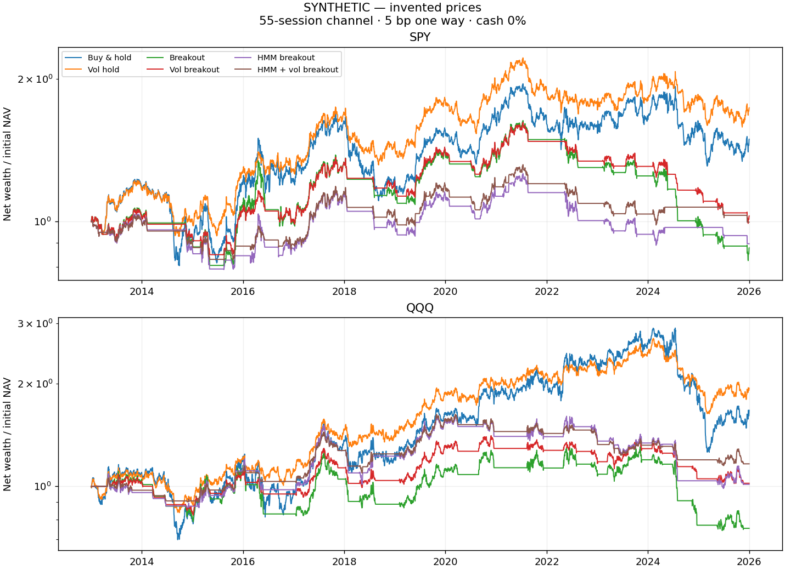
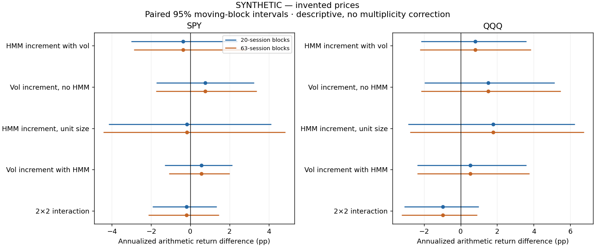
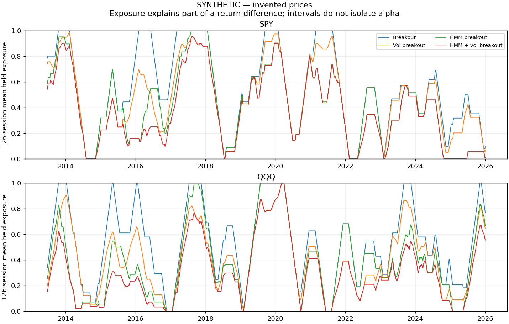

# HMM + volatility-adjusted breakout: frozen transfer experiment

**SYNTHETIC DEMONSTRATION — invented OHLC, no market-performance evidence.**

Question: does the unchanged parent HMM add value to a different trend signal beyond volatility sizing?
Primary: symmetric 55-session prior-high/low channel; 20/100-session and pulse-55 rules are predeclared sensitivities. SPY is primary; QQQ uses identical rules. All 18 strategies, 6 cost/cash scenarios, 4 reporting periods and 5 primary contrasts are retained.

Signals form after close and frozen fractions fill at the next session close. Old units earn pre-fill returns; funded trades charge actual drift-adjusted notional. Accounts start cash in 2013, with no period resets. Cash sensitivity uses continuous ACT/365.25 interest. Adjusted OHLC are model total-return units; no intrabar execution or added dividend.

## Primary methods, full period, 5 bp and zero cash yield

|Asset|Method|Net total return|CAGR|Excess Sharpe|Max drawdown|Realized vol|Turnover/year|Mean held exposure|
|---|---|---:|---:|---:|---:|---:|---:|---:|
|SPY|buy_hold|49.13%|3.01%|0.251|-34.49%|18.94%|0.07|99.94%|
|SPY|vol_hold|73.79%|4.19%|0.354|-28.60%|14.61%|3.93|83.90%|
|SPY|channel55__breakout|-12.15%|-0.96%|-0.000|-49.44%|13.86%|2.75|55.07%|
|SPY|channel55__vol_breakout|2.63%|0.19%|0.071|-38.85%|10.68%|4.17|46.88%|
|SPY|channel55__hmm_breakout|-10.36%|-0.81%|-0.016|-29.45%|11.27%|13.22|41.51%|
|SPY|channel55__hmm_vol_breakout|-0.42%|-0.03%|0.042|-25.46%|9.17%|12.80|37.08%|
|QQQ|buy_hold|66.95%|3.88%|0.279|-56.71%|23.97%|0.07|99.94%|
|QQQ|vol_hold|93.77%|5.04%|0.391|-39.86%|15.76%|4.83|73.17%|
|QQQ|channel55__breakout|-24.66%|-2.08%|-0.042|-43.17%|16.75%|2.82|53.42%|
|QQQ|channel55__vol_breakout|2.07%|0.15%|0.070|-28.03%|11.45%|4.52|40.61%|
|QQQ|channel55__hmm_breakout|1.33%|0.10%|0.077|-38.58%|14.05%|26.14|38.74%|
|QQQ|channel55__hmm_vol_breakout|16.37%|1.13%|0.163|-29.20%|9.90%|22.72|30.12%|

## Primary paired comparisons, full period, 5 bp and zero cash yield

|Asset|Comparison|Block|Mean difference/year|95% interval|Held exposure difference|
|---|---|---:|---:|---|---:|
|SPY|hmm_vol_breakout minus vol_breakout|20|-0.37%|[-3.01%, 2.39%]|-9.80%|
|SPY|hmm_vol_breakout minus vol_breakout|63|-0.37%|[-2.88%, 2.80%]|-9.80%|
|SPY|vol_breakout minus breakout|20|0.76%|[-1.73%, 3.25%]|-8.19%|
|SPY|vol_breakout minus breakout|63|0.76%|[-1.75%, 3.39%]|-8.19%|
|SPY|hmm_breakout minus breakout|20|-0.18%|[-4.16%, 4.13%]|-13.56%|
|SPY|hmm_breakout minus breakout|63|-0.18%|[-4.43%, 4.85%]|-13.56%|
|SPY|hmm_vol_breakout minus hmm_breakout|20|0.57%|[-1.31%, 2.15%]|-4.43%|
|SPY|hmm_vol_breakout minus hmm_breakout|63|0.57%|[-1.10%, 2.00%]|-4.43%|
|SPY|interaction|20|-0.20%|[-1.93%, 1.35%]|3.76%|
|SPY|interaction|63|-0.20%|[-2.14%, 1.46%]|3.76%|
|QQQ|hmm_vol_breakout minus vol_breakout|20|0.81%|[-2.15%, 3.60%]|-10.50%|
|QQQ|hmm_vol_breakout minus vol_breakout|63|0.81%|[-2.22%, 3.85%]|-10.50%|
|QQQ|vol_breakout minus breakout|20|1.51%|[-1.97%, 5.13%]|-12.81%|
|QQQ|vol_breakout minus breakout|63|1.51%|[-2.15%, 5.47%]|-12.81%|
|QQQ|hmm_breakout minus breakout|20|1.79%|[-2.88%, 6.23%]|-14.68%|
|QQQ|hmm_breakout minus breakout|63|1.79%|[-2.76%, 6.74%]|-14.68%|
|QQQ|hmm_vol_breakout minus hmm_breakout|20|0.53%|[-2.36%, 3.60%]|-8.62%|
|QQQ|hmm_vol_breakout minus hmm_breakout|63|0.53%|[-2.36%, 3.75%]|-8.62%|
|QQQ|interaction|20|-0.98%|[-3.09%, 0.98%]|4.18%|
|QQQ|interaction|63|-0.98%|[-3.22%, 0.91%]|4.18%|

## All predeclared window sensitivities, full period, 5 bp and zero cash yield

|Asset|Method|Net CAGR|Excess Sharpe|Drawdown|Exposure|
|---|---|---:|---:|---:|---:|
|SPY|buy_hold|3.01%|0.251|-34.49%|99.94%|
|SPY|vol_hold|4.19%|0.354|-28.60%|83.90%|
|SPY|channel55__breakout|-0.96%|-0.000|-49.44%|55.07%|
|SPY|channel55__vol_breakout|0.19%|0.071|-38.85%|46.88%|
|SPY|channel55__hmm_breakout|-0.81%|-0.016|-29.45%|41.51%|
|SPY|channel55__hmm_vol_breakout|-0.03%|0.042|-25.46%|37.08%|
|SPY|channel20__breakout|-0.93%|-0.005|-47.84%|50.21%|
|SPY|channel20__vol_breakout|-0.30%|0.025|-34.83%|43.28%|
|SPY|channel20__hmm_breakout|-2.88%|-0.219|-35.25%|36.65%|
|SPY|channel20__hmm_vol_breakout|-2.06%|-0.188|-25.99%|33.08%|
|SPY|channel100__breakout|1.01%|0.142|-36.47%|54.57%|
|SPY|channel100__vol_breakout|1.60%|0.203|-28.84%|45.37%|
|SPY|channel100__hmm_breakout|1.59%|0.198|-25.58%|40.15%|
|SPY|channel100__hmm_vol_breakout|1.81%|0.247|-22.99%|35.26%|
|SPY|pulse55__breakout|0.15%|0.057|-14.13%|3.83%|
|SPY|pulse55__vol_breakout|0.27%|0.096|-11.03%|3.13%|
|SPY|pulse55__hmm_breakout|-0.00%|0.016|-9.91%|2.56%|
|SPY|pulse55__hmm_vol_breakout|0.10%|0.049|-8.56%|2.24%|
|QQQ|buy_hold|3.88%|0.279|-56.71%|99.94%|
|QQQ|vol_hold|5.04%|0.391|-39.86%|73.17%|
|QQQ|channel55__breakout|-2.08%|-0.042|-43.17%|53.42%|
|QQQ|channel55__vol_breakout|0.15%|0.070|-28.03%|40.61%|
|QQQ|channel55__hmm_breakout|0.10%|0.077|-38.58%|38.74%|
|QQQ|channel55__hmm_vol_breakout|1.13%|0.163|-29.20%|30.12%|
|QQQ|channel20__breakout|3.91%|0.311|-27.36%|55.04%|
|QQQ|channel20__vol_breakout|2.51%|0.271|-25.97%|41.25%|
|QQQ|channel20__hmm_breakout|2.49%|0.245|-33.39%|40.62%|
|QQQ|channel20__hmm_vol_breakout|1.40%|0.188|-31.76%|31.66%|
|QQQ|channel100__breakout|0.11%|0.090|-39.51%|57.37%|
|QQQ|channel100__vol_breakout|0.87%|0.133|-27.21%|44.13%|
|QQQ|channel100__hmm_breakout|1.25%|0.158|-34.44%|44.34%|
|QQQ|channel100__hmm_vol_breakout|1.86%|0.228|-25.27%|34.38%|
|QQQ|pulse55__breakout|-1.34%|-0.208|-26.51%|4.89%|
|QQQ|pulse55__vol_breakout|-0.57%|-0.131|-17.09%|3.51%|
|QQQ|pulse55__hmm_breakout|-0.82%|-0.142|-20.19%|3.71%|
|QQQ|pulse55__hmm_vol_breakout|-0.45%|-0.116|-16.15%|2.72%|

## Training and equivalence

Refit failures (nonoverlapping periods): 0; failure cash-request days: 0.
Bound parent evidence: True; state/parameter comparisons: 2; control-ledger comparisons: 24. See parent_equivalence.json for tolerances and exact byte checks.

## Interpretation and limitations

Intervals use 2,000 paired noncircular moving-block resamples (20 and 63 sessions, seed 42) of daily net-return differences, annualized as arithmetic means. They are not CAGR intervals or evidence of skill. The interaction is a descriptive difference-in-differences, not a causal estimate. Exposure differences and cash interest can explain apparent improvement. Multiple comparisons are not adjusted.
2013–2017 development, 2018–2020 validation and 2021–2025 historical confirmation are retrospective reporting labels; the parent history was already inspected. Neither QQQ nor these periods are independent unseen samples. Adjustments are current-vintage and not point-in-time. Synthetic OHLC envelopes have no market calibration.
The state gate continuously overlays an independent channel latch. It can reenter after gate recovery without a new breakout; pulse-55 separately reveals dependence on a one-day signal interpretation. Volatility is the same past-20-day log-return estimator, not ATR. Long/cash only, no leverage, intrabar stop, tax, funding spread or market impact model.
Complete metrics.csv retains 864 rows and paired_inference.csv retains 480 rows, including all losing and nonsignificant cases. There is no winner selection or rule tuning after this transfer.
