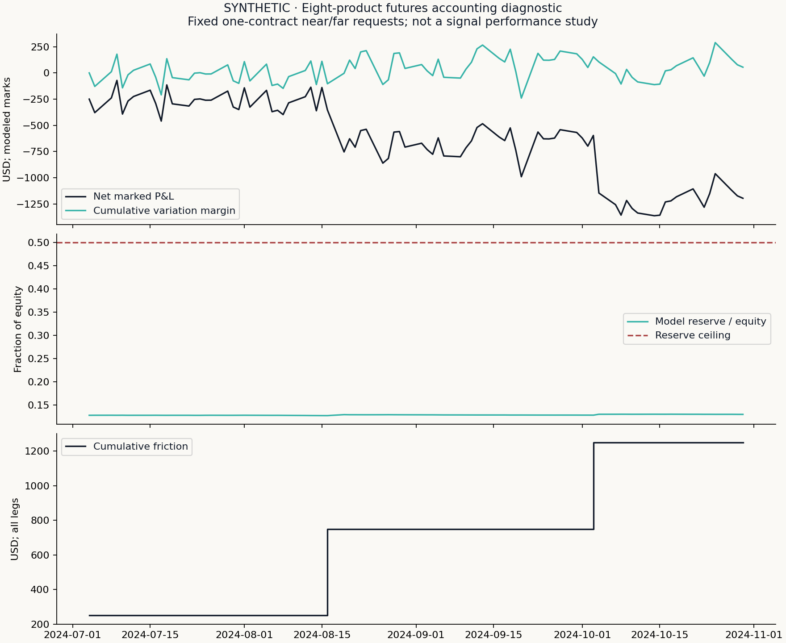
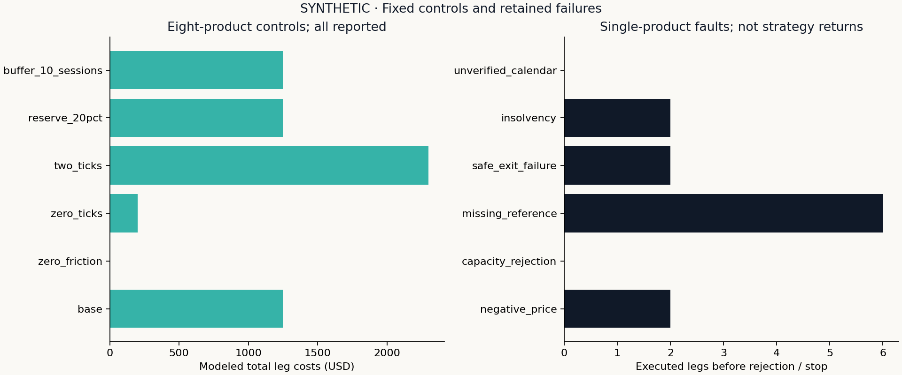

# Futures accounting diagnostic — SYNTHETIC

This is stage 2: contract qualification, fixed near/far requests and a funded ledger.
It is **not** a carry, momentum, basis-momentum or executable-alpha backtest.

- Status: `completed_accounting_diagnostic`.
- Products represented in the input: 8.
- Account dates recorded: 85; executed legs: 64.
- Total modeled costs: $1,250.00.
- Maximum daily cash-bridge error: $0.0000000001.
- Data source: strategy_lab.commodities.fixture; seed=20261026.
- Rights: Original generated fixture, MIT code; no licensed market prices.

Read `selections.csv` for every considered contract and exclusion; `decisions.csv`
for frozen quantities and observation/availability clocks; `trades.csv` for each
leg's reference price, commission and tick cost; `holdings.csv` for signed positions;
and `ledger.csv` for cash, provisional variation margin, encumbered reserves and
stale marks. `events.csv` retains rejected baskets and funding/safe-exit failures.

## Interpretation

The fixture tests a mechanism; synthetic dollar outcomes are not empirical evidence.
Each leg pays $2.50 commission plus 1
outright ticks per side. Margin is a 10% gross-based model
reserve without offsets, capped at 50% of account equity;
it is not SPAN or a broker's historical requirement. Selection uses lagged activity;
the 1% participation cap is a scenario, not measured fills.

Settlement is a retrospective marking reference. Cash timestamps do not reproduce
clearing intraday calls. Independent legs must all have a reference and modeled
capacity; an all-or-none basket is an idealization, not a guaranteed spread fill.
Negative settlements are permitted; no log or price-denominator return is used.
Full strategy inference and historical specification/calendar certification remain
separate acceptance gates. A future-known revision never changes an earlier target,
but current-vintage revisions can change this retrospective marked ledger.

## Predeclared synthetic controls and failures

Every row below is reported. One-product faults deliberately have a different scope from the eight-product controls.

|Scenario|Products|Status|Executed legs|Costs (USD)|
|---|---:|---|---:|---:|
|base|8|completed_accounting_diagnostic|64|1,250.00|
|zero_friction|8|completed_accounting_diagnostic|64|0.00|
|zero_ticks|8|completed_accounting_diagnostic|64|200.00|
|two_ticks|8|completed_accounting_diagnostic|64|2,300.00|
|reserve_20pct|8|completed_accounting_diagnostic|64|1,250.00|
|buffer_10_sessions|8|completed_accounting_diagnostic|64|1,250.00|
|negative_price|1|completed_accounting_diagnostic|2|25.00|
|capacity_rejection|1|completed_no_qualified_trades|0|0.00|
|missing_reference|1|completed_accounting_diagnostic|6|75.00|
|safe_exit_failure|1|failed_safe_exit|2|25.00|
|insolvency|1|failed_nonpositive_equity|2|25.00|
|unverified_calendar|1|completed_no_qualified_trades|0|0.00|

See [scenario summary](scenarios/scenario-summary.csv) and each scenario's retained ledger and events. No failed path is discarded.

