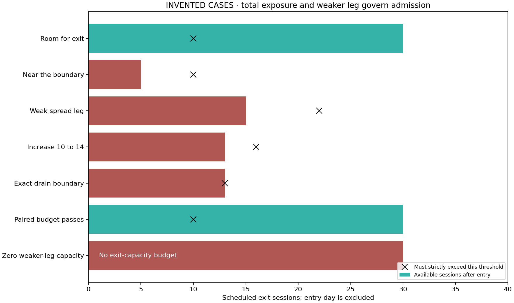

# Invented entry / exit budget cases

These seven inputs are deliberately constructed accounting/risk cases. They use
no WRDS records, observed trading outcomes or market-calibrated fill estimates.
The exact helper used by the research engine produces CASES.csv.

Green means the fixed budget passes; red means the addition is refused. A pass
is not a fill. Pending exits, quotes/activity, shared side capacity and funding
remain separate execution checks. The black marker is an excluded boundary:
available sessions must strictly exceed both ten and projected drainage plus two.

The increase from ten to fourteen units is tested on fourteen, not the increment
four. For a spread, the weaker leg's allowance and earliest deadline govern the
whole paired request. Zero capacity has no finite drain budget. Entry day cannot
be credited as a future retirement day because it books at the EOD reference.

See docs/COMMODITY_ADMISSION.md and tests/test_commodity_entry_budget.py in the
repository for the complete protocol and executable invariants. This diagram is
not a trading-performance result or evidence of future liquidity.
