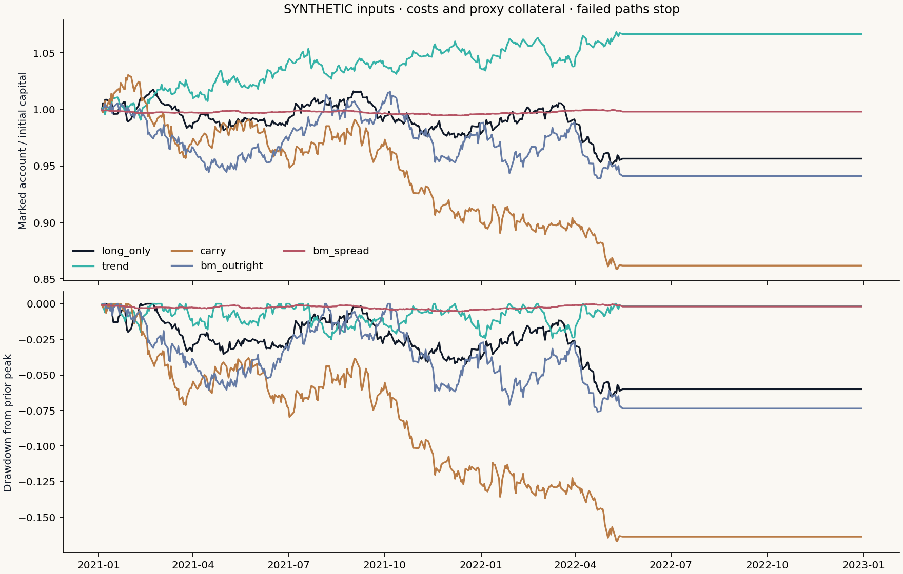
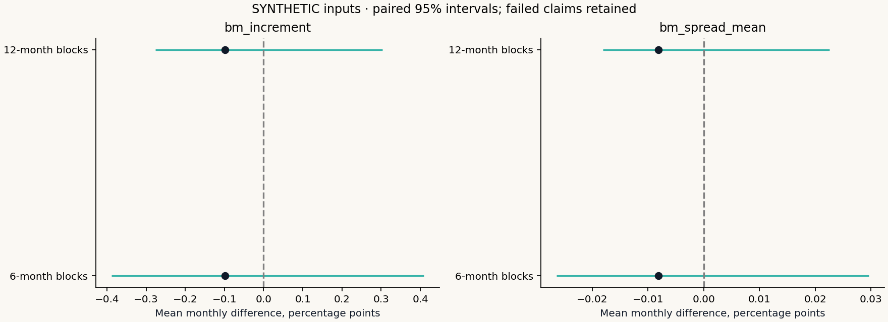
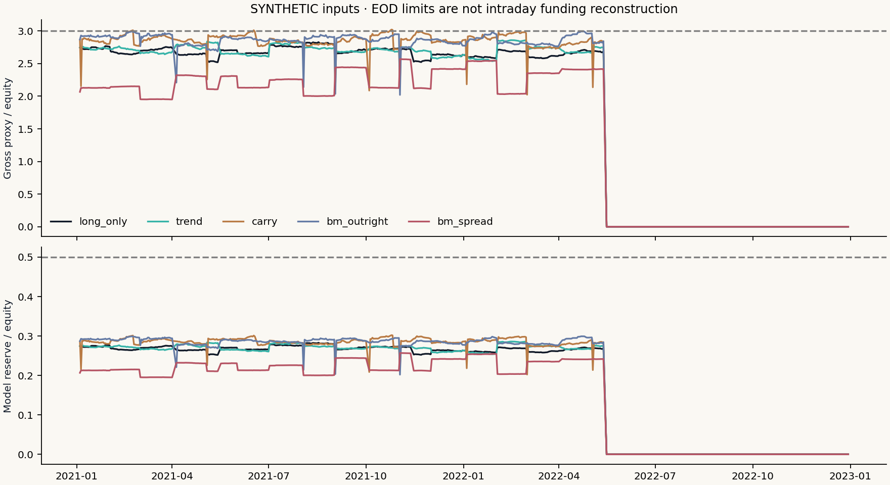
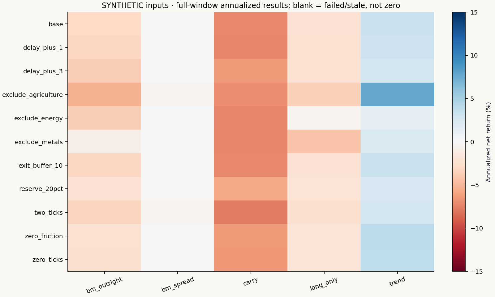
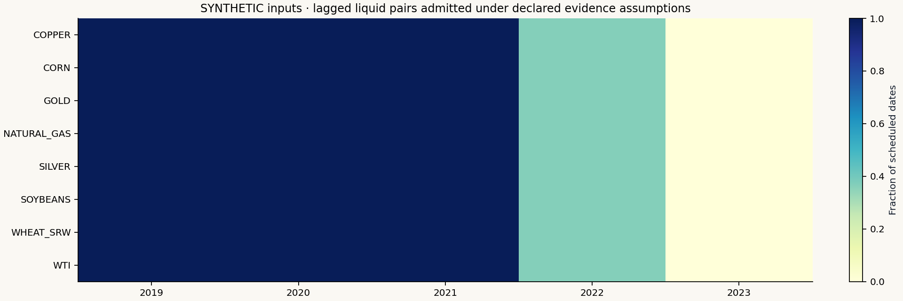
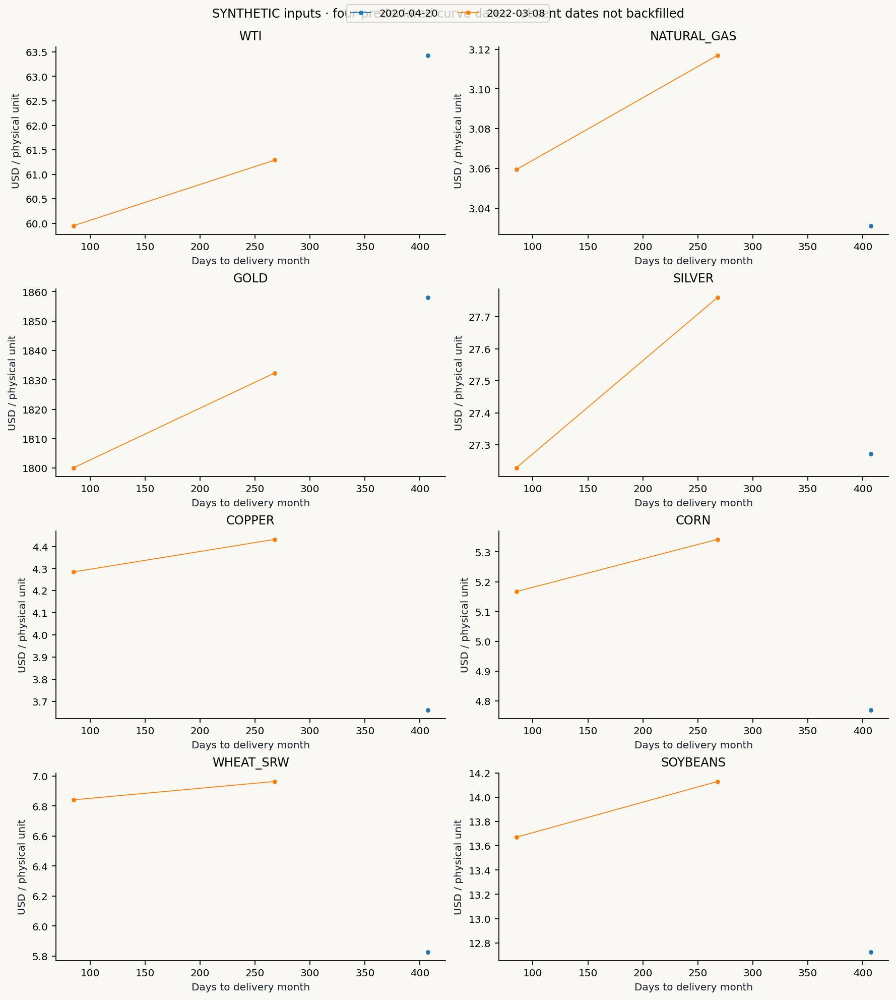

# Commodity curves — SYNTHETIC DEMONSTRATION

Exploratory scheduled-calendar study; current-vintage inputs, proxy collateral and modeled fills. Not complete PIT or actual trading.

## Fixed hypotheses and evidence

Five rules, all predeclared costs/delays/sectors and both failed and completed paths are retained. The known FND/LTD boundary is not complete first-position history. Source rows outside the rule calendar remain in a separate exclusion artifact.

## Base accounts

|Strategy|Status|Last date|Observed ending USD|Costs USD|
|---|---|---|---:|---:|
|long_only|completed_exploratory_path|2022-12-30|956,469.75|5,550.00|
|trend|completed_exploratory_path|2022-12-30|1,066,667.97|7,855.00|
|carry|completed_exploratory_path|2022-12-30|861,868.50|15,805.00|
|bm_outright|completed_exploratory_path|2022-12-30|941,094.70|10,140.00|
|bm_spread|completed_exploratory_path|2022-12-30|998,041.78|6,650.00|

Ending values of failed paths cover different horizons and must not be ranked as full-period performance. Stale/incomplete months are ineligible for inference; they are not silently dropped.

## Paired uncertainty

The real protocol uses historical 2020–2025 confirmation, not unseen future data. The invented demonstration instead evaluates its entire synthetic 2021–2022 window and makes no validation claim. The benchmark sums separate $500k trend/carry account values, with each sleeve's own costs and integer quantities. Moving noncircular blocks use 6/12 months, 5,000 draws, seed 20261026; two-sided centered-null p-values and Holm family size two are retained.

## Funding and failures

## Contract coverage and curve mechanism

## Interpretation and limits

Carry measures a curve slope, trend a past near rolling return, and basis-momentum the difference between compounded near/far histories. Reference histories use the same contract at both endpoints, not a continuous-price jump. They are signal measurements, not proof of fills. Every scheduled interval must be present for a completed month.

The rules calendar excludes declared holiday patterns, including Juneteenth from 2022. It does not reconstruct unexpected closures or original notices. Daily references may combine different source times; synchronous EOD booking is not an intraday funding simulation. The 10%/20% reserves are assumptions, without spread credits or broker add-ons. Fixed $2.50/side and outright ticks are modeled friction. No spot premium or convenience yield is independently identified.

Later-decision scenarios postpone signal updates; they are not latency replays of an unchanged submitted order. Sector removals suppress those requests without reranking. All wealth paths retain continuous capital across periods. Integer rounding and rejected baskets can materially change results.

## Reproduction and provenance

See FROZEN_RUN.json, RUN_MANIFEST.json, summary.csv, paired_inference.csv, failure_counts.csv and each account's ledger/trades/RECEIPT.json. Base accounts also retain decisions, holdings and per-contract variation margin. Source rights remain those of the input manifest; restricted results are private.
