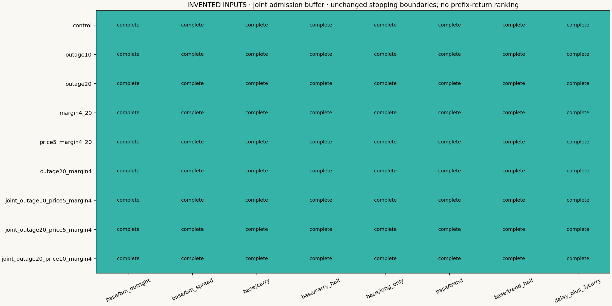
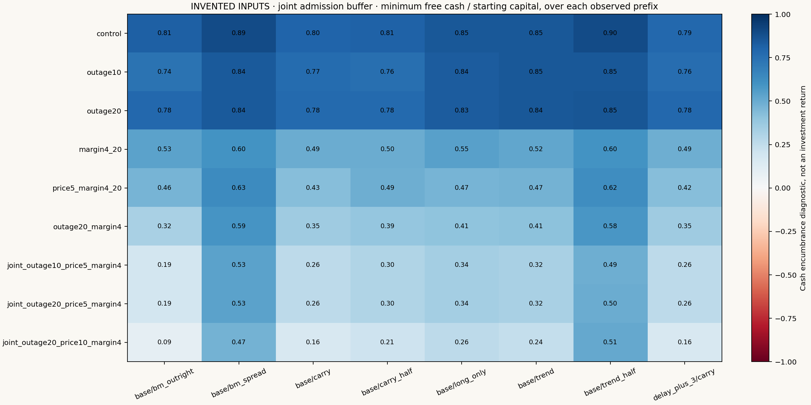
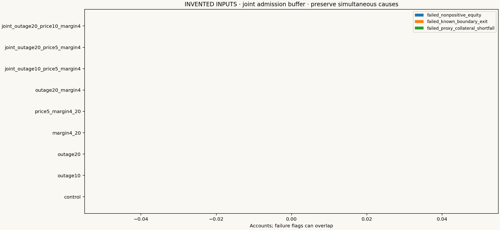

# Longer outages, adverse prices and collateral pressure

## Fixed admission extension

This run enables a predeclared joint buffer. Require R >20+ceil(full target/weaker lagged capacity)+2; start paired retirement earlier using the same outage allowance. Before rounding, one closed-form sizing cap reserves a 10% adverse gross-price loss, 40% gross collateral after a 10% absolute-price increase, two-sided fees and 10% of known cash.

Known admission cash is min(d−2 recorded equity, own prior-EOD cash). A single portfolio envelope uses max(abs(day-start holdings), abs(proposed target)) for each leg, keeping old contracts during replacements; expected exits release no budget. Admit optional additions together only if loss + stressed reserve + round-trip fees + cash buffer <= known cash. Reductions remain available on refusal. Inspect resilience_entries and resilience_budgets for every daily inequality and existing-only deficit.

The old fixed cohorts, sides and anchors remain identical even when this gate prevents exposure; do not move shocks to chase new entries. Count no-trade/unexposed outcomes. This one-shock envelope is not a bound on unmodeled gaps, cumulative shocks, future natural price changes or post-admission liquidity. No profit optimization or guaranteed survival claim.

INVENTED INPUTS · joint admission buffer. Nine scenarios × eight funded accounts = 72 dependent paths. All magnitudes and windows were fixed before results.

## Read the experiment correctly

Outages last 10/20 scheduled sessions; reserve can rise from 10% to 40% of gross. A 5%/10% additive leg-price step is adverse to the frozen baseline side, using its last available absolute USD settlement through d−2. Both spread members can move against their respective sides: this is a basis deformation, not a common parallel move. Steps persist after the outage rather than creating a favorable automatic rebound. Fixed annual cohorts and signs do not move or flip when the stressed account differs.

Historical signal directions, contract selection and unit-risk reference histories stay fixed. Shocked references affect actual VM, execution and collateral; only lagged shocked price history enters the gross price basis. This conditional fixed-policy test is not a fully re-estimated trading system or a calibrated market equilibrium. Missing quotes stay missing, negative references are allowed, and costs remain the original fixed assumptions.

Each account has its own baseline-directed adverse path. Cross-strategy alpha, a shared-market benchmark comparison and confidence intervals for such a premium would be inappropriate here; none are supplied. Earlier historical research and failed paths remain available.

## Every result, including stopped prefixes

|Case|Account|Primary status|End date|Min equity USD|Min free cash USD|Max collateral shortfall USD|
|---|---|---|---|---:|---:|---:|
|control|base/long_only|completed_exploratory_path|2022-12-30|989,013.07|846,989.10|0.00|
|outage10|base/long_only|completed_exploratory_path|2022-12-30|986,299.17|835,833.98|0.00|
|outage20|base/long_only|completed_exploratory_path|2022-12-30|988,856.10|833,591.14|0.00|
|margin4_20|base/long_only|completed_exploratory_path|2022-12-30|987,323.50|546,005.85|0.00|
|price5_margin4_20|base/long_only|completed_exploratory_path|2022-12-30|886,137.90|467,927.05|0.00|
|outage20_margin4|base/long_only|completed_exploratory_path|2022-12-30|993,515.19|405,619.65|0.00|
|joint_outage10_price5_margin4|base/long_only|completed_exploratory_path|2022-12-30|876,673.64|338,566.33|0.00|
|joint_outage20_price5_margin4|base/long_only|completed_exploratory_path|2022-12-30|883,469.74|337,726.98|0.00|
|joint_outage20_price10_margin4|base/long_only|completed_exploratory_path|2022-12-30|776,052.88|264,539.07|0.00|
|control|base/trend|completed_exploratory_path|2022-12-30|995,511.73|848,012.84|0.00|
|outage10|base/trend|completed_exploratory_path|2022-12-30|999,483.09|846,647.51|0.00|
|outage20|base/trend|completed_exploratory_path|2022-12-30|997,891.33|844,370.40|0.00|
|margin4_20|base/trend|completed_exploratory_path|2022-12-30|997,983.75|517,653.49|0.00|
|price5_margin4_20|base/trend|completed_exploratory_path|2022-12-30|908,734.94|469,684.47|0.00|
|outage20_margin4|base/trend|completed_exploratory_path|2022-12-30|997,891.33|407,399.49|0.00|
|joint_outage10_price5_margin4|base/trend|completed_exploratory_path|2022-12-30|884,200.79|323,994.71|0.00|
|joint_outage20_price5_margin4|base/trend|completed_exploratory_path|2022-12-30|890,743.04|323,994.71|0.00|
|joint_outage20_price10_margin4|base/trend|completed_exploratory_path|2022-12-30|777,770.54|236,802.13|0.00|
|control|base/carry|completed_exploratory_path|2022-12-30|947,154.98|797,572.98|0.00|
|outage10|base/carry|completed_exploratory_path|2022-12-30|905,290.92|766,670.83|0.00|
|outage20|base/carry|completed_exploratory_path|2022-12-30|915,114.47|778,620.38|0.00|
|margin4_20|base/carry|completed_exploratory_path|2022-12-30|947,335.33|492,341.98|0.00|
|price5_margin4_20|base/carry|completed_exploratory_path|2022-12-30|807,209.11|427,596.24|0.00|
|outage20_margin4|base/carry|completed_exploratory_path|2022-12-30|920,924.37|353,605.51|0.00|
|joint_outage10_price5_margin4|base/carry|completed_exploratory_path|2022-12-30|772,570.64|257,968.44|0.00|
|joint_outage20_price5_margin4|base/carry|completed_exploratory_path|2022-12-30|774,249.76|257,968.44|0.00|
|joint_outage20_price10_margin4|base/carry|completed_exploratory_path|2022-12-30|646,671.58|162,331.37|0.00|
|control|base/bm_outright|completed_exploratory_path|2022-12-30|968,251.16|813,548.93|0.00|
|outage10|base/bm_outright|completed_exploratory_path|2022-12-30|885,796.84|737,414.25|0.00|
|outage20|base/bm_outright|completed_exploratory_path|2022-12-30|938,960.53|784,067.68|0.00|
|margin4_20|base/bm_outright|completed_exploratory_path|2022-12-30|974,312.73|531,865.64|0.00|
|price5_margin4_20|base/bm_outright|completed_exploratory_path|2022-12-30|851,663.54|461,413.53|0.00|
|outage20_margin4|base/bm_outright|completed_exploratory_path|2022-12-30|949,002.40|321,262.20|0.00|
|joint_outage10_price5_margin4|base/bm_outright|completed_exploratory_path|2022-12-30|742,155.99|187,182.67|0.00|
|joint_outage20_price5_margin4|base/bm_outright|completed_exploratory_path|2022-12-30|784,043.36|186,379.77|0.00|
|joint_outage20_price10_margin4|base/bm_outright|completed_exploratory_path|2022-12-30|612,275.95|90,717.72|0.00|
|control|base/bm_spread|completed_exploratory_path|2022-12-30|998,397.40|894,290.86|0.00|
|outage10|base/bm_spread|completed_exploratory_path|2022-12-30|994,542.30|842,092.96|0.00|
|outage20|base/bm_spread|completed_exploratory_path|2022-12-30|995,971.65|843,522.31|0.00|
|margin4_20|base/bm_spread|completed_exploratory_path|2022-12-30|998,234.64|598,740.51|0.00|
|price5_margin4_20|base/bm_spread|completed_exploratory_path|2022-12-30|928,345.97|631,481.21|0.00|
|outage20_margin4|base/bm_spread|completed_exploratory_path|2022-12-30|996,247.23|592,396.54|0.00|
|joint_outage10_price5_margin4|base/bm_spread|completed_exploratory_path|2022-12-30|919,182.81|533,633.67|0.00|
|joint_outage20_price5_margin4|base/bm_spread|completed_exploratory_path|2022-12-30|923,315.13|533,633.67|0.00|
|joint_outage20_price10_margin4|base/bm_spread|completed_exploratory_path|2022-12-30|849,127.24|473,197.75|0.00|
|control|base/trend_half|completed_exploratory_path|2022-12-30|498,400.37|447,686.13|0.00|
|outage10|base/trend_half|completed_exploratory_path|2022-12-30|490,830.37|424,149.03|0.00|
|outage20|base/trend_half|completed_exploratory_path|2022-12-30|494,174.36|427,493.02|0.00|
|margin4_20|base/trend_half|completed_exploratory_path|2022-12-30|496,085.56|299,577.30|0.00|
|price5_margin4_20|base/trend_half|completed_exploratory_path|2022-12-30|469,193.19|311,938.03|0.00|
|outage20_margin4|base/trend_half|completed_exploratory_path|2022-12-30|495,324.30|291,520.40|0.00|
|joint_outage10_price5_margin4|base/trend_half|completed_exploratory_path|2022-12-30|457,803.60|245,856.16|0.00|
|joint_outage20_price5_margin4|base/trend_half|completed_exploratory_path|2022-12-30|459,519.11|247,790.00|0.00|
|joint_outage20_price10_margin4|base/trend_half|completed_exploratory_path|2022-12-30|426,505.96|256,540.59|0.00|
|control|base/carry_half|completed_exploratory_path|2022-12-30|472,489.85|402,709.63|0.00|
|outage10|base/carry_half|completed_exploratory_path|2022-12-30|445,773.95|378,509.50|0.00|
|outage20|base/carry_half|completed_exploratory_path|2022-12-30|454,005.98|389,180.37|0.00|
|margin4_20|base/carry_half|completed_exploratory_path|2022-12-30|471,292.71|249,976.59|0.00|
|price5_margin4_20|base/carry_half|completed_exploratory_path|2022-12-30|418,169.85|244,791.26|0.00|
|outage20_margin4|base/carry_half|completed_exploratory_path|2022-12-30|459,912.74|194,524.81|0.00|
|joint_outage10_price5_margin4|base/carry_half|completed_exploratory_path|2022-12-30|396,558.64|149,141.74|0.00|
|joint_outage20_price5_margin4|base/carry_half|completed_exploratory_path|2022-12-30|400,599.83|149,141.74|0.00|
|joint_outage20_price10_margin4|base/carry_half|completed_exploratory_path|2022-12-30|345,668.62|103,758.67|0.00|
|control|delay_plus_3/carry|completed_exploratory_path|2022-12-30|934,911.88|787,905.76|0.00|
|outage10|delay_plus_3/carry|completed_exploratory_path|2022-12-30|905,242.00|763,916.11|0.00|
|outage20|delay_plus_3/carry|completed_exploratory_path|2022-12-30|922,701.96|784,312.90|0.00|
|margin4_20|delay_plus_3/carry|completed_exploratory_path|2022-12-30|942,008.42|486,750.49|0.00|
|price5_margin4_20|delay_plus_3/carry|completed_exploratory_path|2022-12-30|804,174.04|422,733.77|0.00|
|outage20_margin4|delay_plus_3/carry|completed_exploratory_path|2022-12-30|924,445.92|353,605.51|0.00|
|joint_outage10_price5_margin4|delay_plus_3/carry|completed_exploratory_path|2022-12-30|776,842.88|257,968.44|0.00|
|joint_outage20_price5_margin4|delay_plus_3/carry|completed_exploratory_path|2022-12-30|786,272.91|257,968.44|0.00|
|joint_outage20_price10_margin4|delay_plus_3/carry|completed_exploratory_path|2022-12-30|654,224.02|162,331.37|0.00|

Different stop dates imply different observed horizons. Prefix minima are diagnostics, not comparable full-period return/risk estimates. Severity need not monotonically rank ending dollars once accounts stop.

## Failure causes and paired exposure

The selected primary status follows the existing engine; all simultaneous equity, delivery-boundary and cash-shortfall events remain in all_failure_flags and the event logs. A 50% risk-buffer breach alone is not insolvency. No deadline extension, external top-up, new price floor or unobserved liquidation is used.

Both spread legs reduce equal units bounded by the weaker current offer and shared daily sides. A zero-capacity member blocks the paired fill. New risk is gated against both day-start and planned post-reduction inventory, retaining v0.7.1. Reserve is encumbered cash, not another expense: equity = prior equity + VM − costs. Terminal reconciliation uses shocked open-position marks together with shocked fills.

## Reproduction and evidence

Inspect FROZEN_RUN.json, FROZEN_COHORTS.csv, FROZEN_LEGS.csv, summary.csv and RUN_MANIFEST.json. Account price_events.csv records signed USD steps; its hypothetical full-baseline-leg impulse is not the account’s realized P&L. Compare actual pnl/holdings/trades, admissions, exit plans and stress budgets/sessions. terminal_inventory.csv preserves remaining legs, mark offsets, deadline, offered/used/remaining capacity, cash and every failure flag.

Reproduce: python -m strategy_lab.commodities.joint_report --fixture --output NEW_DIRECTORY. Licensed work uses --input PRIVATE_INPUT --cohorts FROZEN_PRIVATE_CSV --legs FROZEN_PRIVATE_LEGS; keep outputs private.

Scheduled calendars, current-vintage metadata and missing first-position archives remain limitations. Reserve is a proxy without historical SPAN/spread credits or broker add-ons. EOD paired references are not intraday queues, real close-out or proven tradability. This deterministic conditional stress has no occurrence-probability, worst-possible-shock or unseen-OOS claim. Only original code/methods/tests and invented inputs are public; licensed sources, anchors, event dates and all real derived findings stay private. Research direction was selected by Mingju Zhang; implementation/experiments were AI-assisted and unaided review remains separately tracked.
