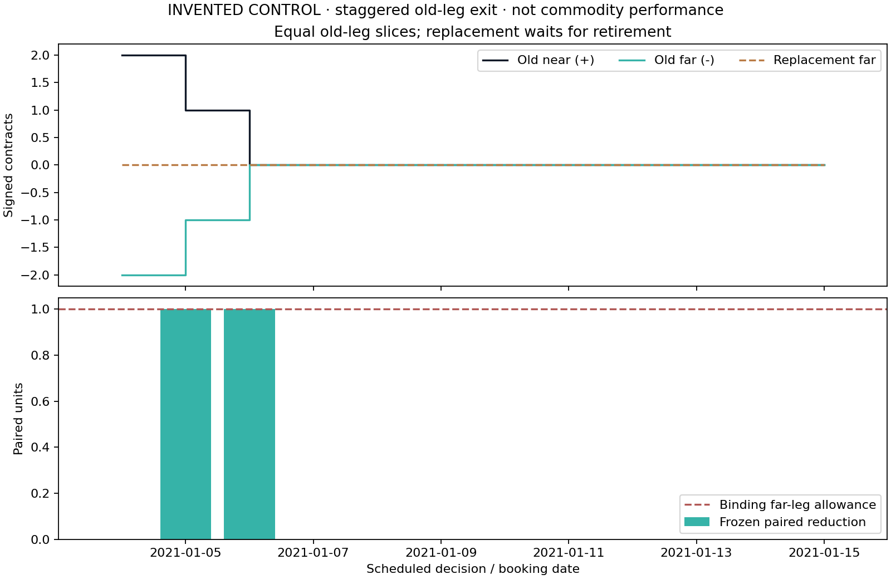

# Invented paired-retirement trace

This is a deliberately controlled accounting experiment. Requests use fixed
positive spread directions on original generated curves. They are not the
cross-sectional strategy results or market-calibrated order flow.

Initial WTI spread size is 2 paired units under the recorded risk rule.
The artificial near allowance is 3, far allowance 1;
both are defined relative to that initial size to expose multi-day ordering.
The roll request changes the pair on the next session. No return objective is
used to set these capacities. The smaller old-leg allowance limits each slice.

TRACE.csv records actual day-end holdings; EXIT_PLANS.csv records frozen intent;
TRADES.csv records modeled fills and both side costs. Replacement orders wait
for the latched old goal; overlap consumes remaining daily capacity and can be
rejected even after the old basket has become flat. Later replacement holdings
are a different pair and are not added to the old-pair neutrality check.

No WRDS records or derived real findings are included. See the repository's
docs/COMMODITY_STAGED_EXITS.md for the separate early-retirement protocol.
