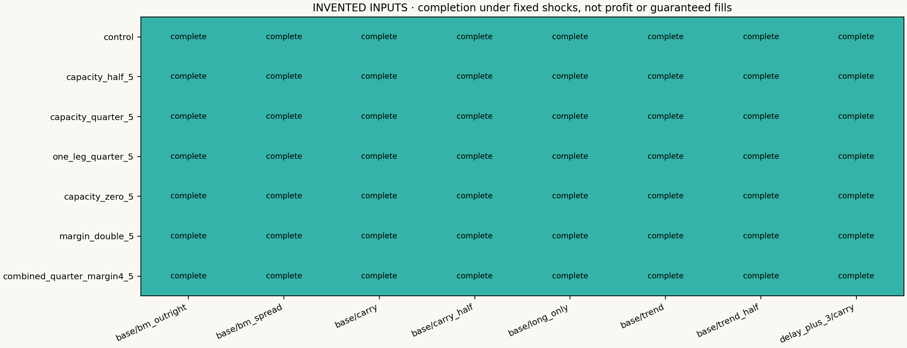
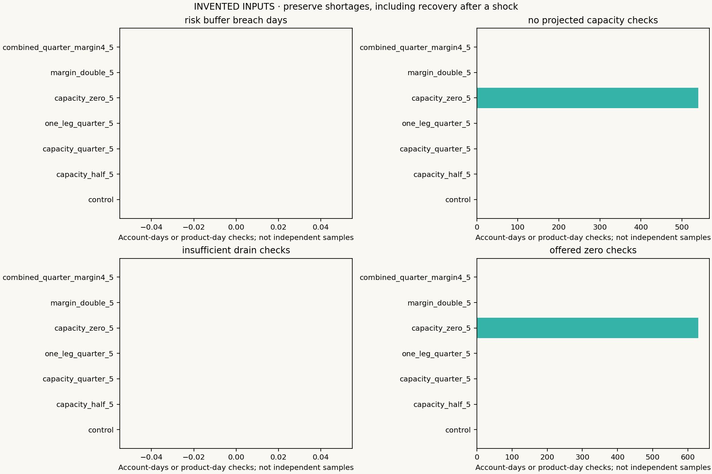
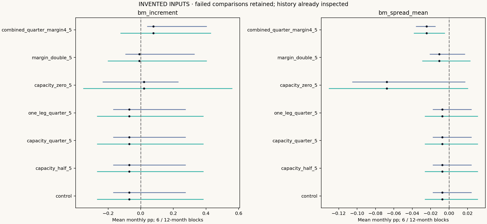

# Post-admission capacity and collateral stress

INVENTED INPUTS. Fixed events and parameters; no return tuning. This is a robustness test of modeled execution, not actual SPAN, calibrated supply or new independent OOS.

## Experiment

Seven cases × eight funded accounts = 56 paths. Cases use fixed five-session half/quarter/one-leg-quarter/zero capacity offers, doubled proxy collateral, and a combined quarter-capacity/fourfold-collateral case. The existing $2.50/side, ticks, risk sizing, entry budget and hard boundary are retained.

Freeze each product/year first baseline addition; shock its fixed contracts from the next scheduled day. Events do not move when the stressed account takes a different path. Capacity is hypothetical available participation, not edited vendor volume. Current surprises affect fills; only observations ending d−2 affect planning. Announced current-day reserve multipliers affect funding, and overlaps use max rather than compound.

## Every path, including failures

|Case|Account|Status|End|Observed ending USD|Costs USD|
|---|---|---|---|---:|---:|
|control|base/long_only|completed_exploratory_path|2022-12-30|952,840.68|5,400.00|
|capacity_half_5|base/long_only|completed_exploratory_path|2022-12-30|952,840.68|5,400.00|
|capacity_quarter_5|base/long_only|completed_exploratory_path|2022-12-30|952,840.68|5,400.00|
|one_leg_quarter_5|base/long_only|completed_exploratory_path|2022-12-30|952,840.68|5,400.00|
|capacity_zero_5|base/long_only|completed_exploratory_path|2022-12-30|984,853.04|6,130.00|
|margin_double_5|base/long_only|completed_exploratory_path|2022-12-30|962,903.80|6,260.00|
|combined_quarter_margin4_5|base/long_only|completed_exploratory_path|2022-12-30|969,087.57|8,390.00|
|control|base/trend|completed_exploratory_path|2022-12-30|1,059,012.97|6,385.00|
|capacity_half_5|base/trend|completed_exploratory_path|2022-12-30|1,059,012.97|6,385.00|
|capacity_quarter_5|base/trend|completed_exploratory_path|2022-12-30|1,059,012.97|6,385.00|
|one_leg_quarter_5|base/trend|completed_exploratory_path|2022-12-30|1,059,012.97|6,385.00|
|capacity_zero_5|base/trend|completed_exploratory_path|2022-12-30|1,057,306.27|7,200.00|
|margin_double_5|base/trend|completed_exploratory_path|2022-12-30|1,053,039.64|7,165.00|
|combined_quarter_margin4_5|base/trend|completed_exploratory_path|2022-12-30|1,029,016.07|9,195.00|
|control|base/carry|completed_exploratory_path|2022-12-30|862,309.19|14,515.00|
|capacity_half_5|base/carry|completed_exploratory_path|2022-12-30|862,309.19|14,515.00|
|capacity_quarter_5|base/carry|completed_exploratory_path|2022-12-30|862,309.19|14,515.00|
|one_leg_quarter_5|base/carry|completed_exploratory_path|2022-12-30|862,309.19|14,515.00|
|capacity_zero_5|base/carry|completed_exploratory_path|2022-12-30|821,324.71|17,450.00|
|margin_double_5|base/carry|completed_exploratory_path|2022-12-30|855,085.93|15,130.00|
|combined_quarter_margin4_5|base/carry|completed_exploratory_path|2022-12-30|856,956.99|17,755.00|
|control|base/bm_outright|completed_exploratory_path|2022-12-30|942,840.81|9,780.00|
|capacity_half_5|base/bm_outright|completed_exploratory_path|2022-12-30|942,840.81|9,780.00|
|capacity_quarter_5|base/bm_outright|completed_exploratory_path|2022-12-30|942,840.81|9,780.00|
|one_leg_quarter_5|base/bm_outright|completed_exploratory_path|2022-12-30|942,840.81|9,780.00|
|capacity_zero_5|base/bm_outright|completed_exploratory_path|2022-12-30|917,967.21|12,810.00|
|margin_double_5|base/bm_outright|completed_exploratory_path|2022-12-30|948,005.68|10,680.00|
|combined_quarter_margin4_5|base/bm_outright|completed_exploratory_path|2022-12-30|961,959.13|14,295.00|
|control|base/bm_spread|completed_exploratory_path|2022-12-30|998,213.61|6,330.00|
|capacity_half_5|base/bm_spread|completed_exploratory_path|2022-12-30|998,213.61|6,330.00|
|capacity_quarter_5|base/bm_spread|completed_exploratory_path|2022-12-30|998,213.61|6,330.00|
|one_leg_quarter_5|base/bm_spread|completed_exploratory_path|2022-12-30|998,213.61|6,330.00|
|capacity_zero_5|base/bm_spread|completed_exploratory_path|2022-12-30|983,854.66|7,630.00|
|margin_double_5|base/bm_spread|completed_exploratory_path|2022-12-30|997,406.56|6,730.00|
|combined_quarter_margin4_5|base/bm_spread|completed_exploratory_path|2022-12-30|994,171.69|9,800.00|
|control|base/trend_half|completed_exploratory_path|2022-12-30|530,661.87|2,985.00|
|capacity_half_5|base/trend_half|completed_exploratory_path|2022-12-30|530,661.87|2,985.00|
|capacity_quarter_5|base/trend_half|completed_exploratory_path|2022-12-30|530,661.87|2,985.00|
|one_leg_quarter_5|base/trend_half|completed_exploratory_path|2022-12-30|530,661.87|2,985.00|
|capacity_zero_5|base/trend_half|completed_exploratory_path|2022-12-30|510,521.46|3,330.00|
|margin_double_5|base/trend_half|completed_exploratory_path|2022-12-30|528,554.25|3,210.00|
|combined_quarter_margin4_5|base/trend_half|completed_exploratory_path|2022-12-30|516,409.84|4,250.00|
|control|base/carry_half|completed_exploratory_path|2022-12-30|431,142.42|6,920.00|
|capacity_half_5|base/carry_half|completed_exploratory_path|2022-12-30|431,142.42|6,920.00|
|capacity_quarter_5|base/carry_half|completed_exploratory_path|2022-12-30|431,142.42|6,920.00|
|one_leg_quarter_5|base/carry_half|completed_exploratory_path|2022-12-30|431,142.42|6,920.00|
|capacity_zero_5|base/carry_half|completed_exploratory_path|2022-12-30|408,583.81|8,520.00|
|margin_double_5|base/carry_half|completed_exploratory_path|2022-12-30|423,959.32|7,215.00|
|combined_quarter_margin4_5|base/carry_half|completed_exploratory_path|2022-12-30|429,801.69|8,545.00|
|control|delay_plus_3/carry|completed_exploratory_path|2022-12-30|867,363.71|14,290.00|
|capacity_half_5|delay_plus_3/carry|completed_exploratory_path|2022-12-30|867,363.71|14,290.00|
|capacity_quarter_5|delay_plus_3/carry|completed_exploratory_path|2022-12-30|867,363.71|14,290.00|
|one_leg_quarter_5|delay_plus_3/carry|completed_exploratory_path|2022-12-30|867,363.71|14,290.00|
|capacity_zero_5|delay_plus_3/carry|completed_exploratory_path|2022-12-30|808,802.22|17,355.00|
|margin_double_5|delay_plus_3/carry|completed_exploratory_path|2022-12-30|871,271.68|15,135.00|
|combined_quarter_margin4_5|delay_plus_3/carry|completed_exploratory_path|2022-12-30|870,438.47|17,785.00|

Stopped paths have different horizons: ending dollars are not comparable full-period returns. These paths share data, signals and shock schedules; 56 paths are not 56 independent statistical observations.

## Budget and funding diagnostics

Retirement may receive a smaller paired fill than its frozen request. The weaker leg and cumulative used sides bound both legs together. Optional additions remain whole-request. A refusal cannot restore outgoing inventory. Zero supply retains old risk; no liquidation is invented.

Above the 50% reserve/equity risk buffer, lagged value and the announced rate request proportional integer paired reductions and block new risk. A buffer breach is distinct from actual modeled collateral exceeding all cash at EOD. The latter stops as failed_proxy_collateral_shortfall; neither outside funding nor a reserve-as-expense debit is introduced.

## Historical economic comparisons

The same two claims, 6/12-month moving blocks, 5,000 draws and Holm family size two remain. Failed/incomplete months are not silently dropped; missing comparisons are not evaluable. Inspect paired_inference.csv for every phase and case. Already-inspected history does not become unseen OOS after a new split.

## Read the evidence

FROZEN_RUN.json binds inputs, code and cases. FROZEN_COHORTS.csv fixes events; all_windows.csv preserves schedules even when unexposed. Per-account stress_budgets.csv.gz distinguishes conservative known capacity from offered current supply, time to the old deadline and drainage slack. stress_sessions.csv.gz separates risk-buffer breaches from cash shortfalls. Compare those with exit_plans, admissions, ordered fills and cash ledgers. A qualified entry does not reserve future liquidity.

Source unit blockers, scheduled calendars, current-vintage contract evidence, missing historical first-position notices and proxy reserves retain their limitations. Only original code/methods and invented fixtures are publishable here. Licensed sources, their cohorts and all real derived results remain private. Research direction was selected by Mingju Zhang; implementation/experiments were AI-assisted and unaided review is tracked separately.

Reproduce: python -m strategy_lab.commodities.stress_report --fixture --output NEW_DIRECTORY. For licensed research, use --input PRIVATE_INPUT --cohorts FROZEN_PRIVATE_CSV and keep outputs private.
