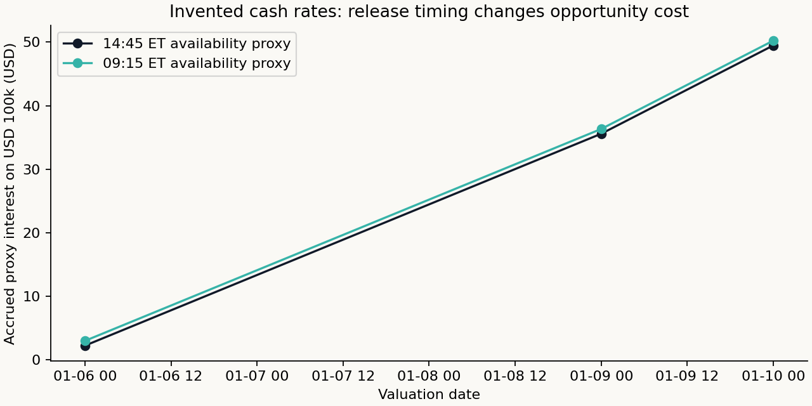

# Information Clocks and Action Units

All values and security identifiers in this report are **invented known-answer fixtures**.

The USD 100k opportunity-cost account earns $49.484862 under the primary 14:45 clock and $50.237532 under the retained 09:15 clock. These are arithmetic examples, not observed EFFR or attainable investment returns. The Friday-to-Monday interval accrues three calendar days using the rate already available at Friday close. Neither benchmark changes strategy orders.

The separate action example has a $1 cash distribution: `(99 + 1) / 100 − 1 = 0`. Its missing declaration clock still blocks use before the ex-date open. A declared 2-for-1 split gives `49.5 × 2 / 99 − 1 = 0`. A correct amount does not establish its historical publication time. These adjustments affect reference prices and lagged total-return features; the intraday account receives no dividend for overnight shares it did not hold.

[Methods and limits](../../docs/INTRADAY_SOURCE_AUDIT.md) · [Tests](../../tests/test_intraday_actions.py)
