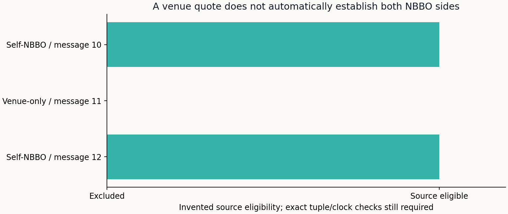

# Evidence Before Admission

All clocks, quantities, securities and publication examples here are **invented**.

Three messages at offsets 600, 800 and 1,100 ns collapse to one microsecond label.
The original SIP remainder restores their order only after exact quote/quantity
matching and documented lot conversion. At the illustrated 1,000 ns arrival,
the first two messages are too early; the third is eligible. A same-time label
cannot justify picking the largest displayed quantity. Half-quantum ties,
missing tuples and conflicting sequence scopes remain quarantined.

The publication examples distinguish an actual amount release, a calendar,
a printed document date and a release at the decision. Only the verified earlier
amount passes. These inputs are analyst attestations exercised as a known-answer
test; the function does not authenticate a document or prove feed availability.

[Methods](../../docs/INTRADAY_EVIDENCE.md) · [Tests](../../tests/test_intraday_evidence.py)

## Which source may supply the missing observations?

The new invented input uses three CQM messages and documented UTP source-code
semantics. Messages 10 and 12 carry self-NBBO indicator 4. Message 11 is an
ordinary venue quote and is excluded even though its prices look plausible.
The remaining source-eligible rows do **not** cover all three coarse tuples;
the original cluster would therefore remain unresolved. Source eligibility is
only the first gate, not permission to complete a book with guessed prices.

The dated master fixture has an exact SYNTH symbol with a 100-share lot and a
SYNTHX lookalike with a 10-share lot. Only the exact identity supplies units.
Conflicting identities and missing dates are not filled from nearby records.
Cross-file copies of one SIP message cannot create additional displayed size.

For a release listing precise only to a minute, use the end of that minute as a
conservative availability bound. A bound equal to the decision still fails the
strict-before test. These examples contain no licensed market observations.
