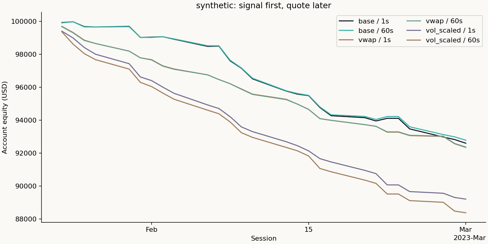

# Intraday Execution Study

Data kind: **synthetic**.



```csv
variant,delay_seconds,sessions,status,net_pnl_usd,max_drawdown,missing_quotes,financing_borrow
base,1,27,complete,-7397.234056,-0.073972,0,30.270799
base,60,27,complete,-7215.387597,-0.072154,0,30.300888
vwap,1,27,complete,-7649.953761,-0.0765,0,9.177984
vwap,60,27,complete,-7631.396735,-0.076314,0,9.179454
vol_scaled,1,27,complete,-10794.989644,-0.10795,0,26.165356
vol_scaled,60,27,complete,-11623.613454,-0.116236,0,27.015417
```

The offline fixture is invented and is not performance evidence. Quote models cross the observed bid/ask after the decision plus the declared latency; they do not demonstrate actual routing or queue priority. Missing exit quotes retain inventory and stop the account; remaining equity is provisional. Initial margin, fees, slippage, financing, borrow availability and participation are declared proxies. A higher scaled return does not isolate a stronger signal. Historical licensed results remain private.
