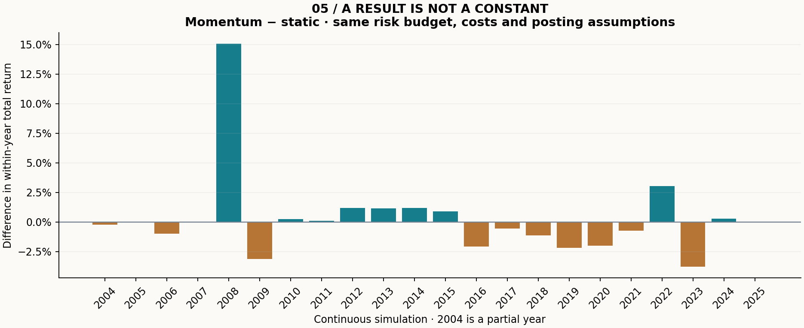
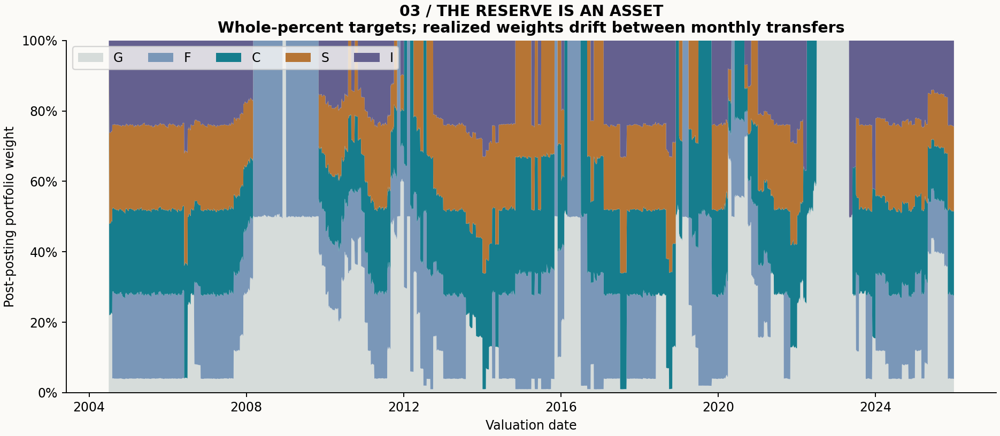
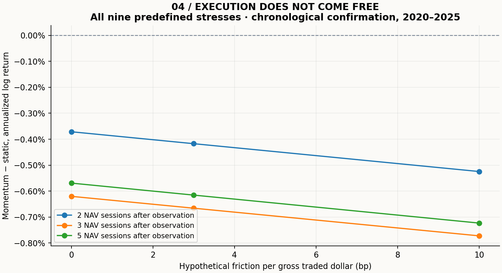

# Real multi-asset NAV allocation study

**Data:** official public TSP fund share NAV facts, 2 June 2003–31 December 2025; current historical vintage captured in October 2026. **Results:** modeled allocations on real fund NAVs, not observed trades or ETF returns. Investment income and operating expenses are embedded in NAV; cash dividends added separately: **zero**.

**Main finding:** In 2020–2025, momentum returned 30.69% versus 33.97% for the static control. Its annualized paired log-return difference was -0.42%, with a 20-session block 95% interval [-3.23%, 2.33%]. Both prespecified interval lengths contain zero: True. The confirmation evidence does not establish an incremental momentum advantage.

## Read the comparison

Momentum and static use identical trailing covariance scaling, whole-percent targets, risk limits, initial G holdings, posting delays and costs. The control shares the risk budget; realized volatility need not match. C and G buy-and-hold contextualize opportunity cost. All start with $100,000 in G at the previous supplied NAV. Three basis points apply to every gross dollar bought or sold, including G: moving between two funds incurs both legs. This is a hypothetical friction stress, not a measured TSP charge.

|Window|Strategy|Total return|Annualized return|Excess Sharpe vs G|Maximum drawdown|Annual gross turnover|
|---|---|---:|---:|---:|---:|---:|
|full|Momentum|311.33%|6.86%|0.434|-26.67%|2.87×|
|full|Shared-risk-budget static|274.63%|6.40%|0.371|-26.67%|0.96×|
|full|C buy & hold|829.19%|11.03%|0.490|-55.22%|0.09×|
|full|G reserve|87.44%|2.99%|n/a|0.00%|0.00×|
|development|Momentum|136.56%|8.62%|0.626|-13.39%|2.37×|
|development|Shared-risk-budget static|100.73%|6.92%|0.408|-24.35%|0.93×|
|development|C buy & hold|130.49%|8.35%|0.339|-55.22%|0.19×|
|development|G reserve|39.87%|3.27%|n/a|0.00%|0.00×|
|validation|Momentum|33.05%|5.93%|0.473|-14.89%|3.93×|
|validation|Shared-risk-budget static|39.31%|6.92%|0.566|-14.11%|0.56×|
|validation|C buy & hold|73.97%|11.82%|0.728|-19.37%|0.00×|
|validation|G reserve|11.86%|2.29%|n/a|0.00%|0.00×|
|confirmation|Momentum|30.69%|4.61%|0.183|-26.67%|2.88×|
|confirmation|Shared-risk-budget static|33.97%|5.05%|0.216|-26.67%|1.34×|
|confirmation|C buy & hold|131.72%|15.22%|0.636|-33.83%|0.00×|
|confirmation|G reserve|19.80%|3.09%|n/a|0.00%|0.00×|

## Chronological validation and uncertainty

Development: July 2004–2014; validation: 2015–2019; confirmation: 2020–2025. Rules were recorded before this implementation calculated returns. No threshold, asset set or stress row is chosen using these results. Covariance is re-estimated strictly from trailing observations, while the specification remains fixed. Holdings continue across boundaries and years, without favorable reset dates. These are historical temporal checks; familiar markets and current-vintage revisions prevent a claim of genuinely unseen, prospective out-of-sample evidence.

The primary comparison is the annualized mean **paired daily log-return difference**, not a CAGR spread or regression alpha. Overlapping moving blocks preserve local serial dependence; 2,000 deterministic resamples, seed 20261023. The two block lengths are both retained. Percentile intervals are descriptive and depend on stationarity and block choice; they do not correct for the wider history of strategy discovery.

|Window|Block sessions|Annual log-return difference|95% interval|Contains zero?|
|---|---:|---:|---:|---|
|full|20|0.44%|[-1.06%, 2.16%]|yes|
|full|63|0.44%|[-1.09%, 2.32%]|yes|
|development|20|1.58%|[-0.79%, 4.59%]|yes|
|development|63|1.58%|[-0.99%, 4.97%]|yes|
|validation|20|-0.93%|[-3.10%, 1.46%]|yes|
|validation|63|-0.93%|[-2.62%, 1.06%]|yes|
|confirmation|20|-0.42%|[-3.23%, 2.33%]|yes|
|confirmation|63|-0.42%|[-2.78%, 1.72%]|yes|

## Information and funding clocks

The signal uses observations through date t, with momentum from t−252 through t−21 and covariance through t. A full intervening NAV session is allowed for publication. Targets become frozen after that intervening session, and a request is modeled at 11:00 New York time on t+2, ordinarily posting at that day's closing NAV. The posting NAV is unknown when target percentages are frozen. No exact historical publication timestamp is claimed; outages, corrections and delayed postings are not reconstructed. Delays of 2, 3 and 5 supplied sessions are all reported. Supplied valuation sessions are never forward-filled.

At a month boundary, the previous month's last observation is recognized by the next supplied session; no next-session price enters the signal. Targets are equal allocations across positive-momentum risky funds F/C/S/I, at most 50% per risky fund and 99% risky gross; trailing 126-session covariance scales down toward 10% annual volatility, without leverage. Risky weights are floored to whole percentage points, with the remainder in G. These are target limits, not continuous realized-weight constraints. Posting-month transfer counts never exceed two in the modeled runs. TSP access restrictions and processing rules mean this is an allocation study, not a participant-account replica.

Fees are funded by solving V_after + fee = V_before, with fee proportional to absolute changes in all five dollar holdings. Fractional units are then assigned at the posting NAV. Each day reconciles prior value + embedded-income price P&L − fees = ending value, with no external capital. G earns its observed fund return; it is not an extra cash-interest credit. Taxes, deposits, withdrawals, participant fees, unit rounding and exceptional postings are outside scope. The I Fund changed benchmark during 2024; its realized history is not a constant-index backfill.

## Evidence files and limits

`summary.csv`, `yearly.csv`, `sensitivity.csv`, `metrics.json` and per-strategy ledgers, decisions and orders expose every comparison. Costs use gross two-leg notional, not half-turnover. Annualization uses 252 supplied observations and drawdown includes each window's starting capital. Window metrics are sliced from a continuous simulation and are not separately reoptimized.

`protocol.json` records the pre-result specification; `source.json` identifies the snapshot and rights basis; `manifest.json` binds package sources, data, configuration, environment and all generated files. Public numerical facts are transcribed with attribution; no vendor ETF data, index levels, government logos, course code or employer material is included. See [data rights](../../DATA_RIGHTS.md), [methods](../../docs/METHODS.md) and [limitations](../../docs/PROVENANCE.md). Negative results and intervals containing zero are retained. This study does not establish capacity, exchange fills or tradable alpha.
