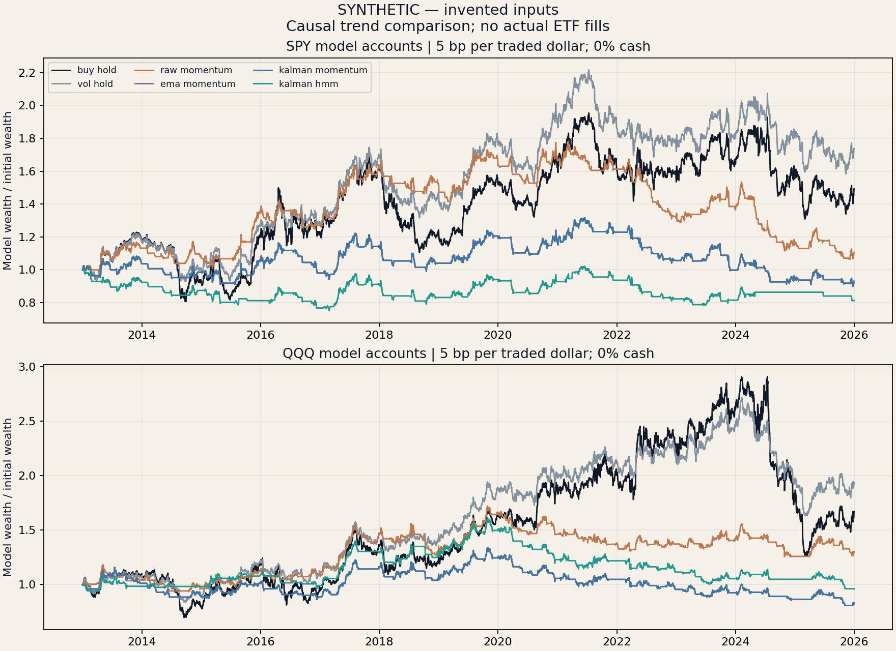
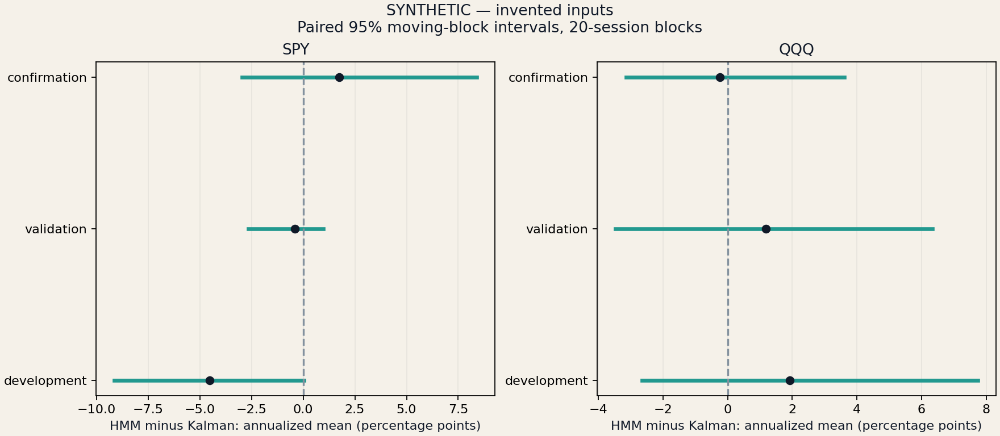

# Online regimes and daily trend — SYNTHETIC / INVENTED INPUTS

Does an online HMM add value beyond smoothing and volatility control?

These are retrospective model total-return-unit accounts, not ETF fills. The synthetic run cannot establish market alpha; current-vintage real data cannot establish historical PIT availability.

## Fixed comparison

SPY is primary; QQQ is a transfer check. Decisions follow the close and execute at the next session close. All six methods share evaluation dates; positions continue across segment boundaries. Buy-and-hold trades once; other methods rebalance daily to frozen fractions. Cost is charged on actual drifted-unit trades. No dividend is added to adjusted prices.

## Confirmation window: 2021–2025

Base scenario: 5 bp per traded dollar; cash earns 0%.

| Asset | Method | CAGR | Excess Sharpe | Max drawdown | Average held exposure | Annual turnover |
|---|---|---:|---:|---:|---:|---:|
| SPY | buy_hold | -1.81% | -0.01 | -33.04% | 100.0% | 0.00x |
| SPY | vol_hold | -1.78% | -0.05 | -28.60% | 84.4% | 4.22x |
| SPY | raw_momentum | -7.65% | -0.70 | -40.35% | 45.0% | 25.81x |
| SPY | ema_momentum | -4.44% | -0.39 | -31.81% | 43.9% | 8.76x |
| SPY | kalman_momentum | -4.44% | -0.39 | -31.81% | 43.9% | 8.76x |
| SPY | kalman_hmm | -2.53% | -0.30 | -23.21% | 27.2% | 14.22x |
| QQQ | buy_hold | -2.37% | 0.03 | -56.71% | 100.0% | 0.00x |
| QQQ | vol_hold | -0.69% | 0.04 | -39.86% | 72.6% | 5.00x |
| QQQ | raw_momentum | -2.24% | -0.15 | -19.50% | 40.7% | 20.61x |
| QQQ | ema_momentum | -4.54% | -0.35 | -26.79% | 41.6% | 8.98x |
| QQQ | kalman_momentum | -4.54% | -0.35 | -26.79% | 41.6% | 8.98x |
| QQQ | kalman_hmm | -4.62% | -0.42 | -25.02% | 33.5% | 32.00x |

## Incremental HMM evidence

| Asset | Block sessions | Annualized paired mean | 95% interval | Exposure difference |
|---|---:|---:|---:|---:|
| SPY | 20 | 1.75% | [-2.95%, 8.40%] | -16.7% |
| SPY | 63 | 1.75% | [-2.75%, 8.64%] | -16.7% |
| QQQ | 20 | -0.24% | [-3.15%, 3.62%] | -8.1% |
| QQQ | 63 | -0.24% | [-2.89%, 3.54%] | -8.1% |

SPY: the fixed base-case confirmation point estimate is positive. Both block-length intervals include zero. Compare the exposure difference before attributing the result to predictive information.
QQQ: the fixed base-case confirmation point estimate is negative. Both block-length intervals include zero. Compare the exposure difference before attributing the result to predictive information.

The statistic is 252 times the paired daily arithmetic-return mean, not a CAGR difference. The intervals are descriptive, dependent-data diagnostics without multiplicity adjustment. A change in exposure is part of the rule; these comparisons do not isolate predictive information from de-risking.

## Training failures retained

| Asset | Refits | Failed refits | Days requesting cash |
|---|---:|---:|---:|
| SPY | 162 | 0 | 0 |
| QQQ | 162 | 0 | 0 |

## Every confirmation sensitivity

20-session-block paired intervals; 63-session results are also retained in the CSV.

| Asset | Cost bp | Cash assumption | HMM minus Kalman annualized mean | 95% interval |
|---|---:|---:|---:|---:|
| SPY | 0 | 0% | 2.02% | [-2.56%, 8.66%] |
| SPY | 0 | 3% | 2.50% | [-2.09%, 9.15%] |
| SPY | 5 | 0% | 1.75% | [-2.95%, 8.40%] |
| SPY | 5 | 3% | 2.23% | [-2.45%, 8.91%] |
| SPY | 10 | 0% | 1.47% | [-3.37%, 8.13%] |
| SPY | 10 | 3% | 1.95% | [-2.90%, 8.58%] |
| QQQ | 0 | 0% | 0.91% | [-1.94%, 4.91%] |
| QQQ | 0 | 3% | 1.14% | [-1.68%, 5.15%] |
| QQQ | 5 | 0% | -0.24% | [-3.15%, 3.62%] |
| QQQ | 5 | 3% | -0.01% | [-2.85%, 3.86%] |
| QQQ | 10 | 0% | -1.39% | [-4.44%, 2.46%] |
| QQQ | 10 | 3% | -1.16% | [-4.18%, 2.69%] |

Failed models request cash until the next scheduled refit. The request takes one session to execute; failure counts are not evidence of trading success. Every failure reason and successful parameter snapshot is retained.

## Complete evidence and limits

`metrics.csv` preserves every asset × method × segment × cost (0/5/10 bp) × cash (0/3%) case. `paired_inference.csv` retains 20/63-session intervals for every case. Asset subfolders contain features, targets, model snapshots, state probabilities, training events, decisions, trades and cash/unit ledgers. `protocol.json` and `manifest.json` bind configuration, code, input and output fingerprints.

Sharpe uses arithmetic excess daily returns. Cash accrues continuously over calendar days; 0% and 3% are assumptions, not observed investment rates. Risk scaling is capped at 100% and need not attain 15% realized volatility. Model units do not establish executable adjusted prices, liquidity, taxes, or corporate-action release availability. Fixed Kalman gains approach the matched EMA: their similarity is expected, not independent confirmation. QQQ shares substantial equity exposure with SPY and is not an independent market. No parameters are chosen by confirmation performance; no positive result is required.
